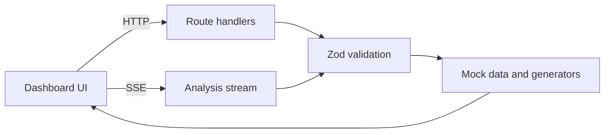

<div align="center">

# 📈 Arthaya

**A stock-market analysis dashboard with streaming multi-agent analysis.**


[Live Demo](https://arthaya.vercel.app) · [Features](#-features) · [Quick Start](#-quick-start) · [API](#-api)

</div>

> ⚠️ **Demo project.** Arthaya uses a demo stock universe with mock and generated data. Prices, predictions, analyses, and model metrics are **illustrative only**, not live market data, not trained-model output, and not financial advice.

---

## ✨ Features

| | Feature | What it does |
|---|---|---|
| 🔍 | **Stock analysis** | Analyze a demo ticker by horizon and depth |
| 📡 | **Live-style streaming** | SSE endpoint streams agent progress, then the final analysis |
| ✅ | **Validation** | Zod-validated inputs; invalid requests and unknown tickers return errors |
| 📊 | **Model performance** | Generated (simulated) metrics with charts |
| 🗂️ | **Dashboard views** | Market info, predictions, reports, agents, data sources, comparisons, watchlists |

**Analysis options**

| Parameter | Values |
|---|---|
| Horizon | `1D` · `5D` · `20D` |
| Depth | `quick` · `standard` · `deep` |
| Tickers | `AAPL` `MSFT` `NVDA` `TSLA` `AMZN` `GOOGL` `RELIANCE` `TCS` `INFY` `HDFCBANK` |

---

## 🖼️ Screenshots

<!-- Add real images, e.g.  -->
*Screenshots coming soon.*

---

## 🧰 Tech Stack

| Layer | Tools |
|---|---|
| Framework | Next.js 16, React 19, TypeScript 5 |
| Styling & motion | Tailwind CSS 4, Framer Motion |
| Charts & icons | Recharts, Lucide React |
| Forms & validation | React Hook Form, `@hookform/resolvers`, Zod |

---

## 🏗️ Architecture



```text
arthaya/
├── src/       # App pages, components, API routes, utilities
├── tests/     # Unit and integration tests
├── docs/      # Project documentation
├── public/    # Static assets
└── package.json
```
<!-- CONFIRM: inner structure of src/ -->

---

## 🔌 API

Route handlers live under `src/app/api` <!-- CONFIRM path -->.

| Group | Purpose |
|---|---|
| Analysis | Validate input and return a demo analysis |
| Analysis stream | SSE: agent progress events → final analysis |
| Stocks · Market | Demo stock and market data |
| Watchlist · Reports · Predictions | Demo dashboard data |
| Agents · Data sources · Model performance | Metadata and simulated metrics |

<!-- CONFIRM: add exact methods, paths, parameters, and status codes from route.ts files -->

---

## 🚀 Quick Start

**Requirements:** Node.js (version compatible with Next.js 16) and npm.

```powershell
git clone <REPOSITORY_URL>
cd arthaya
npm install
npm run dev
```

Open **http://localhost:3000**. No environment variables are documented <!-- CONFIRM: search code for process.env -->.

### Scripts

| Command | Purpose |
|---|---|
| `npm run dev` | Start development server |
| `npm run build` | Production build |
| `npm run start` | Serve production build |
| `npm run lint` | Run ESLint |

<!-- CONFIRM against package.json; add the test command, since a tests/ folder exists -->

---

## ☁️ Deployment

Deployed on Vercel: **[arthaya.vercel.app](https://arthaya.vercel.app)** <!-- CONFIRM -->

To self-host: `npm run build` then `npm run start`.

---

## ⚠️ Limitations

- Demo stock universe only, with mock and generated data
- Model metrics are simulated and do not demonstrate predictive accuracy
- No external market-data integration documented

**Future ideas (not implemented):** real market-data provider, persistent watchlists and reports, authentication.

---

## 🤝 Contributing

```powershell
git checkout -b feature/your-change
npm run lint
npm run build
```

Then push your branch and open a pull request.

---

## 📄 License & Disclaimer

**License:** not yet specified. Add a `LICENSE` file before allowing reuse.

Arthaya is for educational and demonstration purposes. Nothing here is financial, investment, or trading advice.
