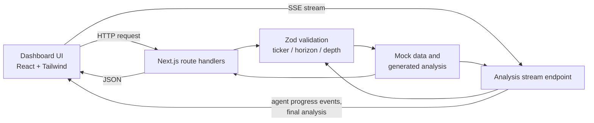

# Arthaya

Arthaya is a stock-market analysis dashboard built with Next.js, React, TypeScript, and Tailwind CSS. It lets users run structured analyses on a demo stock universe across multiple time horizons and analysis depths, and explore related views such as market information, predictions, model performance, reports, agents, data sources, comparisons, and watchlists.

> **Demo notice:** Arthaya currently runs on a demo stock universe with mock and generated data. Prices, analyses, predictions, and model-performance metrics are **illustrative only**. They are not live market data, not the output of a trained machine-learning model, and not independently validated research.

---

## Table of Contents

1. [Key Features](#key-features)
2. [Screenshots](#screenshots)
3. [Technology Stack](#technology-stack)
4. [Architecture and Project Structure](#architecture-and-project-structure)
5. [Application Workflow](#application-workflow)
6. [Analysis Parameters](#analysis-parameters)
7. [API Reference](#api-reference)
8. [Installation and Local Setup](#installation-and-local-setup)
9. [Environment Variables](#environment-variables)
10. [Available Scripts](#available-scripts)
11. [Data Sources and Limitations](#data-sources-and-limitations)
12. [Deployment](#deployment)
13. [Known Limitations and Future Improvements](#known-limitations-and-future-improvements)
14. [Contributing](#contributing)
15. [License and Disclaimer](#license-and-disclaimer)

---

## Key Features

| Feature | Description | Data type |
|---|---|---|
| Stock analysis | Runs an analysis for a demo ticker with a selectable horizon and depth. | Mock / generated |
| Streaming analysis | A Server-Sent Events (SSE) endpoint emits agent progress events and then a final completed analysis. | Mock / generated |
| Input validation | Requests are validated; invalid input and unknown demo tickers return error responses. | Implemented logic |
| Model performance | Displays generated model-performance metrics. | Simulated |
| Dashboard views | Pages for market information, predictions, reports, agents, data sources, comparisons, and watchlists. | Demo <!-- CONFIRM each page exists and what it shows --> |

**Demo stock universe:** AAPL, MSFT, NVDA, TSLA, AMZN, GOOGL, RELIANCE, TCS, INFY, HDFCBANK.

---

## Screenshots

No screenshots are included in the repository yet.

<!--
Add real images, then replace this section, e.g.:

-->

---

## Technology Stack

| Technology | Version | Purpose in Arthaya |
|---|---|---|
| [Next.js](https://nextjs.org/) | 16.3.6 | Application framework, routing, and API route handlers |
| [React](https://react.dev/) | 19.2.8 | User interface |
| [TypeScript](https://www.typescriptlang.org/) | 5 | Static typing |
| [Tailwind CSS](https://tailwindcss.com/) | 4 | Styling |
| [Recharts](https://recharts.org/) | see `package.json` | Charts and data visualization |
| [Zod](https://zod.dev/) | see `package.json` | Schema validation of inputs |
| [React Hook Form](https://react-hook-form.com/) + `@hookform/resolvers` | see `package.json` | Form handling and validation integration |
| [Framer Motion](https://www.framer.com/motion/) | see `package.json` | Animations |
| [Lucide React](https://lucide.dev/) | see `package.json` | Icons |

---

## Architecture and Project Structure

Arthaya is a single Next.js application. The browser-based dashboard calls Next.js route handlers, which validate input and return mock or generated analysis data. No external market-data service is documented here.



Typical Next.js layout (replace with your actual tree before publishing):

```text
arthaya/
├── app/              # Pages and API route handlers   <!-- CONFIRM -->
│   └── api/          # Route handlers (analysis, stream, stocks, ...)
├── components/       # Reusable UI components         <!-- CONFIRM -->
├── lib/              # Validation, mock data, utilities <!-- CONFIRM -->
├── public/           # Static assets
├── package.json
└── tsconfig.json
```

| Area | Responsibility |
|---|---|
| Pages / UI | Dashboard views and reusable components |
| Route handlers | Receive requests, validate input, return JSON or SSE |
| Validation | Zod schemas for ticker, horizon, and depth |
| Mock-data modules | Demo stock universe, analysis content, and model-performance metrics |

---

## Application Workflow

1. Open the dashboard in a browser.
2. Choose a ticker from the demo universe.
3. Select an analysis horizon and depth.
4. The input is validated. Invalid input or an unknown demo ticker returns an error response.
5. Analysis is returned either as a single result or streamed over SSE, where agent progress events arrive first, followed by the final completed analysis.
6. Other views (watchlist, reports, predictions, model performance, comparisons, agents, data sources) present demo content. <!-- CONFIRM details of each -->

---

## Analysis Parameters

| Parameter | Allowed values |
|---|---|
| Horizon | `1D`, `5D`, `20D` |
| Depth | `quick`, `standard`, `deep` |
| Ticker | Demo universe only (see [Key Features](#key-features)) |

Defaults for these parameters: <!-- CONFIRM from the source code -->

---

## API Reference

Arthaya exposes Next.js route handlers. Exact paths, methods, parameters, and status codes must be confirmed from the `route.ts` files. Rows marked CONFIRM are not yet verified.

| Method | Endpoint | Purpose | Parameters | Success | Errors |
|---|---|---|---|---|---|
| CONFIRM | CONFIRM (analysis) | Run a stock analysis | ticker, horizon, depth | JSON analysis | Error for invalid input and unknown demo ticker (status codes CONFIRM) |
| CONFIRM | CONFIRM (analysis stream) | Stream analysis progress | ticker, horizon, depth (CONFIRM) | `text/event-stream`: agent progress events, then final analysis | CONFIRM |
| CONFIRM | CONFIRM (stocks) | Demo stock data | CONFIRM | CONFIRM | CONFIRM |
| CONFIRM | CONFIRM (watchlist) | Watchlist data | CONFIRM | CONFIRM | CONFIRM |
| CONFIRM | CONFIRM (predictions) | Prediction data | CONFIRM | CONFIRM | CONFIRM |
| CONFIRM | CONFIRM (reports) | Report data | CONFIRM | CONFIRM | CONFIRM |
| CONFIRM | CONFIRM (agents) | Agent information | CONFIRM | CONFIRM | CONFIRM |
| CONFIRM | CONFIRM (market) | Market information | CONFIRM | CONFIRM | CONFIRM |
| CONFIRM | CONFIRM (model performance) | Generated metrics | CONFIRM | CONFIRM | CONFIRM |
| CONFIRM | CONFIRM (data sources) | Data source listing | CONFIRM | CONFIRM | CONFIRM |

### SSE behavior

The analysis stream emits agent progress events followed by a final completed analysis. Event names and payload shapes: <!-- CONFIRM from the stream route -->

---

## Installation and Local Setup

### Prerequisites

- Node.js compatible with Next.js 16 <!-- CONFIRM exact minimum version -->
- npm (or the package manager matching your lockfile)
- Git

### Steps (Windows PowerShell)

```powershell
# 1. Clone the repository
git clone <REPOSITORY_URL>

# 2. Enter the project directory
cd arthaya

# 3. Install dependencies
npm install

# 4. Start the development server
npm run dev
```

Open [http://localhost:3000](http://localhost:3000) in your browser (default Next.js port).

---

## Environment Variables

No environment variables are documented for this project. <!-- CONFIRM: search the code for process.env and any .env.example before keeping this line -->

Never commit secrets or private configuration values.

---

## Available Scripts

| Script | Command | Purpose |
|---|---|---|
| `dev` | `npm run dev` | Start the development server |
| `build` | `npm run build` | Create a production build |
| `start` | `npm run start` | Serve the production build |
| `lint` | `npm run lint` | Run linting |

<!-- CONFIRM these four scripts against package.json and remove any that do not exist. Add a test script only if tests exist. -->

---

## Data Sources and Limitations

| Data | Origin |
|---|---|
| Stock universe and prices | Local demo / mock data |
| Analysis content | Mock / generated |
| Predictions | Illustrative |
| Model-performance metrics | Generated; not from a trained or validated model |
| External market-data APIs | None documented <!-- CONFIRM --> |

- Do not treat any output as live or real market data.
- Metrics shown do not demonstrate predictive accuracy or investment performance.
- Illustrative analysis is not a guarantee of future returns and is not personalized financial advice.

---

## Deployment

Arthaya is a standard Next.js application. It has not been deployed publicly, and no live URL is claimed.

```powershell
npm run build
npm run start
```

Any platform that supports Next.js (for example Vercel, or a Node.js host) can run it. No deployment-specific configuration is documented. <!-- CONFIRM none exists -->

---

## Known Limitations and Future Improvements

**Current limitations**

- Uses a fixed demo stock universe with mock and generated data.
- Model-performance metrics are simulated.
- Analysis supports only the horizons and depths listed above.

**Possible future improvements (not implemented)**

- Integrate a real market-data provider.
- Add persistence for watchlists and reports.
- Add authentication.
- Add automated tests.

---

## Contributing

1. Fork or clone the repository.
2. Create a branch:
```powershell
   git checkout -b feature/your-change
```
3. Make your changes.
4. Run the available checks (for example `npm run lint` and `npm run build`).
5. Commit and push your branch, then open a pull request describing your changes.

---

## License and Disclaimer

**License:** No license has been verified for this repository. Add a `LICENSE` file before allowing reuse or redistribution. <!-- CONFIRM -->

**Disclaimer:** Arthaya is an educational and demonstration project. All data, analyses, predictions, and metrics are simulated or illustrative. Nothing here constitutes financial, investment, or trading advice, and it should not be used to make financial decisions.
