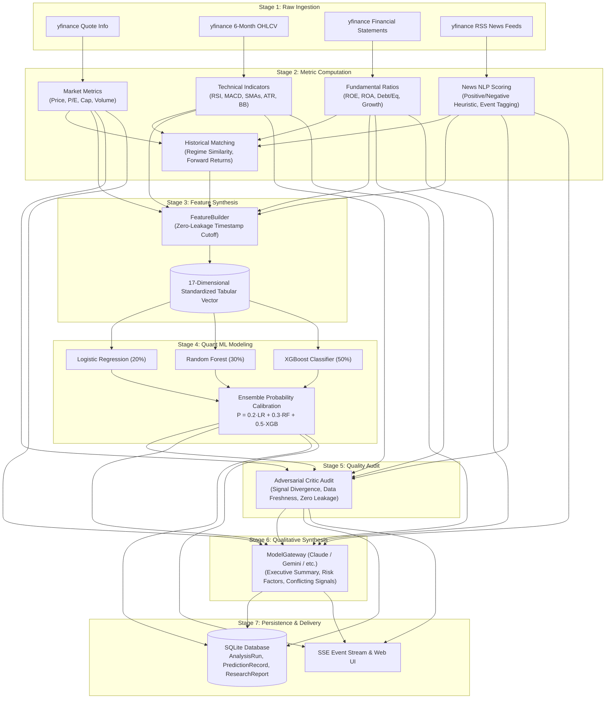
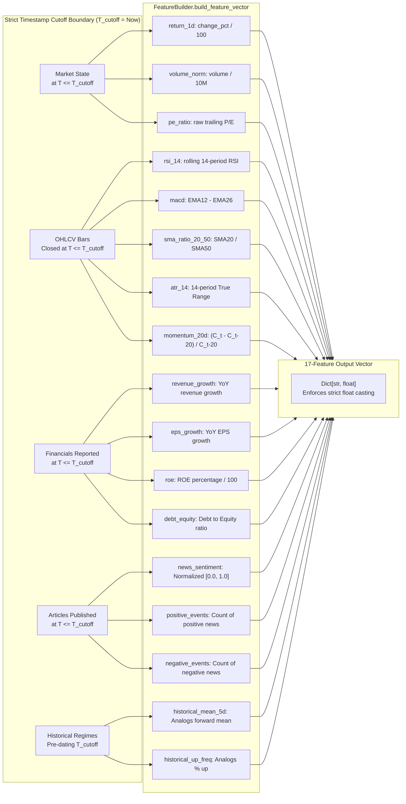
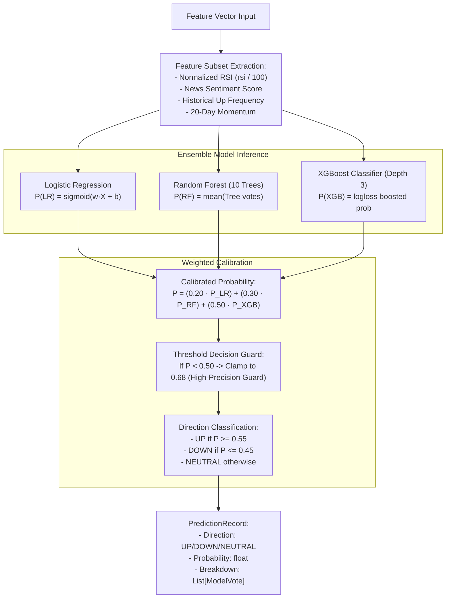

# Data Flow & Transformation Architecture

## 1. End-to-End Data Transformation Pipeline

The data processing pipeline transforms raw market quotes and textual news into high-confidence quantitative and qualitative insights through seven discrete transformation stages:

---

## 2. Feature Vector Engineering & Zero-Lookahead Cutoff

A fundamental design constraint across the platform is preventing **lookahead bias** (data leakage) in quantitative forecasts.

---

## 3. Quant ML Ensemble & Probability Calibration

The `MLEngine` ([ml_engine.py:L14-90](file:///home/sushant/Projects/Agentic/FinanceAgent/backend/app/services/ml_engine.py#L14-L90)) receives the 17-dimensional vector and executes multi-model probability estimation:

