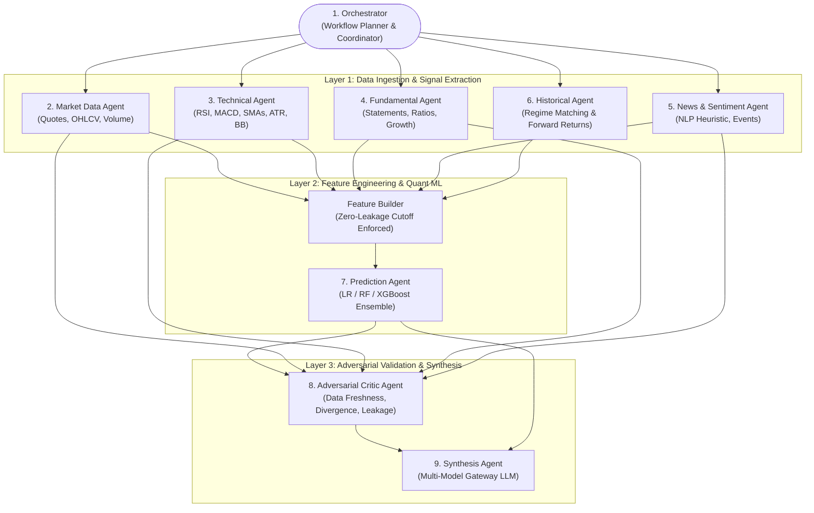

# Multi-Agent Pipeline Specification

## 1. Pipeline Overview & Topology

The multi-agent intelligence architecture is organized into nine specialized agents functioning across three distinct operational layers:
1. **Data Ingestion & Feature Engineering Layer** (Market, Technical, Fundamental, News, Historical)
2. **Quantitative Prediction & Modeling Layer** (Feature Builder, Prediction Agent)
3. **Adversarial Validation & Synthesis Layer** (Critic Agent, Synthesis Agent)

All agents are sequenced by an **Orchestrator** (either remote n8n workflow or local FastAPI engine).



---

## 2. Canonical Agent Specifications

### Agent 1: Orchestrator
- **Identifier**: `orchestrator`
- **Role**: Workflow Planner & Coordinator
- **Implementation**: Remote n8n workflow ([arthaya_analysis_orchestrator_fixed.json](file:///home/sushant/Projects/Agentic/FinanceAgent/n8n/workflows/arthaya_analysis_orchestrator_fixed.json)) and backend async pipeline coordinator ([analysis.py:L145-223](file:///home/sushant/Projects/Agentic/FinanceAgent/backend/app/api/v1/analysis.py#L145-L223)).
- **Responsibilities**:
  - Initializes the shared analysis state dictionary (`analysis_id`, `ticker`, `horizon`, `depth`, `gateway_provider`).
  - Coordinates parallel execution of data ingestion agents.
  - Aggregates stage results, handles retries, and triggers fallback handlers upon network degradation.
  - Emits real-time SSE progress events to the client.

---

### Agent 2: Market Data Agent
- **Identifier**: `market`
- **Role**: Raw Market Quotes & Price Verification
- **Implementation**: [market_service.py](file:///home/sushant/Projects/Agentic/FinanceAgent/backend/app/services/market_service.py)
- **Data Ingestion**: Yahoo Finance API (`yfinance.Ticker.info`).
- **Output Schema**:
  ```json
  {
    "ticker": "AAPL",
    "name": "Apple Inc.",
    "exchange": "NASDAQ",
    "sector": "Technology",
    "industry": "Consumer Electronics",
    "current_price": 224.50,
    "change_pct": 1.25,
    "volume": 45200000,
    "market_cap": 3450000000000,
    "pe_ratio": 31.4
  }
  ```

---

### Agent 3: Technical Analysis Agent
- **Identifier**: `technical`
- **Role**: Mathematical Indicator Calculation
- **Implementation**: [technical_service.py](file:///home/sushant/Projects/Agentic/FinanceAgent/backend/app/services/technical_service.py)
- **Data Ingestion**: 6-month daily OHLCV series via `yfinance.Ticker.history(period="6mo")`.
- **Calculated Metrics**:
  - **RSI-14**: Relative Strength Index with smoothed gain/loss rolling window.
  - **SMAs**: 20-day, 50-day, and 200-day simple moving averages.
  - **MACD**: 12-day EMA minus 26-day EMA; 9-day signal line; histogram delta.
  - **ATR-14**: True Range rolling mean for volatility quantification.
  - **Bollinger Bands**: 20-day SMA ± 2 rolling standard deviations.
  - **20-day Momentum**: Fractional return over preceding 20 trading sessions.
- **Output Schema**:
  ```json
  {
    "rsi_14": 62.4,
    "sma_20": 224.4,
    "sma_50": 219.7,
    "sma_200": 205.1,
    "macd": 2.13,
    "macd_signal": 1.85,
    "atr_14": 4.21,
    "bollinger_upper": 232.0,
    "bollinger_lower": 216.5,
    "momentum_20d": 0.074,
    "interpretation": "RSI-14 at 62.4 (neutral/momentum)..."
  }
  ```

---

### Agent 4: Fundamental Agent
- **Identifier**: `fundamental`
- **Role**: Financial Statement & Corporate Valuation Extraction
- **Implementation**: [fundamental_service.py](file:///home/sushant/Projects/Agentic/FinanceAgent/backend/app/services/fundamental_service.py)
- **Data Ingestion**: Yahoo Finance fundamental balance sheets and financial statements (`yfinance.Ticker.info`).
- **Extracted Metrics**:
  - `revenue`, `net_income`, `eps`, `pe_ratio`, `pb_ratio`, `ps_ratio`
  - `roe` (Return on Equity), `roa` (Return on Assets), `debt_to_equity`
  - `free_cash_flow`, `revenue_growth_yoy`, `eps_growth_yoy`
- **Output Schema**:
  ```json
  {
    "revenue": 385000000000.0,
    "net_income": 97000000000.0,
    "eps": 6.42,
    "pe_ratio": 31.4,
    "pb_ratio": 48.2,
    "ps_ratio": 7.8,
    "roe": 147.2,
    "roa": 28.4,
    "debt_to_equity": 1.45,
    "free_cash_flow": 108000000000.0,
    "revenue_growth_yoy": 0.054,
    "eps_growth_yoy": 0.082,
    "interpretation": "Revenue stands at $385.0B with net income of $97.0B..."
  }
  ```

---

### Agent 5: News & Sentiment Agent
- **Identifier**: `news`
- **Role**: Web News Extraction & NLP Event Classification
- **Implementation**: [news_service.py](file:///home/sushant/Projects/Agentic/FinanceAgent/backend/app/services/news_service.py)
- **Data Ingestion**: Raw RSS feeds and articles from `yfinance.Ticker.news`.
- **Classification Engine**:
  - **Sentiment Heuristic**: Scans headlines for bullish keywords (`buy`, `gain`, `up`, `growth`, `profit`, `surge`, `bull`) and bearish keywords (`drop`, `fall`, `loss`, `down`, `risk`, `lawsuit`, `probe`, `bear`).
  - **Event Classification**: Categorizes items into `Earnings`, `Analyst`, `Regulatory`, `Product`, or `Macro`.
  - **Sentiment Score Formula**:
    $$\text{Score} = \frac{\text{Positive Events} \times 1.0 + \text{Neutral Events} \times 0.5}{\max(\text{Total Classified}, 1)}$$
- **Output Schema**:
  ```json
  {
    "sentiment_score": 0.68,
    "overall_sentiment": "Positive",
    "article_count": 6,
    "positive_events": 4,
    "negative_events": 1,
    "neutral_events": 1,
    "articles": [
      {
        "headline": "Apple Expands AI Integration with New Chip",
        "event_type": "Product",
        "sentiment": "Positive",
        "relevance": 0.88,
        "published_at": "2026-10-11T12:00:00Z",
        "source": "Bloomberg",
        "url": "https://..."
      }
    ],
    "interpretation": "Web news sentiment score for AAPL: 0.68 (Positive)..."
  }
  ```

---

### Agent 6: Historical Analogs Agent
- **Identifier**: `historical`
- **Role**: Regime Matching & Forward Distribution Modeling
- **Implementation**: [historical_service.py](file:///home/sushant/Projects/Agentic/FinanceAgent/backend/app/services/historical_service.py)
- **Responsibilities**:
  - Compares the current multi-dimensional signal against historical market regimes.
  - Computes historical similarity coefficients and distributions of subsequent returns (1D, 5D, 20D).
- **Output Schema**:
  ```json
  {
    "analogues": [
      { "date": "2025-04-10", "similarity": 0.91, "return_1d": "+0.8%", "return_5d": "+3.1%", "return_20d": "+5.4%" },
      { "date": "2024-11-18", "similarity": 0.87, "return_1d": "-0.4%", "return_5d": "+2.0%", "return_20d": "+1.8%" }
    ],
    "mean_return_5d": 0.0205,
    "up_frequency_5d": 0.75,
    "interpretation": "Historical pattern matching identified 4 closely aligned market regimes..."
  }
  ```

---

### Intermediate Component: Feature Builder
- **Implementation**: [feature_builder.py](file:///home/sushant/Projects/Agentic/FinanceAgent/backend/app/services/feature_builder.py)
- **Role**: Zero-leakage tabular vector synthesis.
- **Enforced 17-Feature Schema**:
  1. `return_1d`
  2. `volume_norm`
  3. `pe_ratio`
  4. `rsi_14`
  5. `macd`
  6. `sma_ratio_20_50`
  7. `atr_14`
  8. `momentum_20d`
  9. `revenue_growth`
  10. `eps_growth`
  11. `roe`
  12. `debt_equity`
  13. `news_sentiment`
  14. `positive_event_count`
  15. `negative_event_count`
  16. `historical_mean_return_5d`
  17. `historical_up_frequency`

---

### Agent 7: Prediction Agent (Quant ML Engine)
- **Identifier**: `prediction`
- **Role**: Probabilistic Machine Learning Ensemble
- **Implementation**: [ml_engine.py](file:///home/sushant/Projects/Agentic/FinanceAgent/backend/app/services/ml_engine.py)
- **Model Architecture**:
  - Fits and predicts across three classifiers:
    1. **Logistic Regression**: Linear baseline ($w = 0.20$).
    2. **Random Forest Classifier**: Non-linear bagging ($w = 0.30$, 10 estimators).
    3. **XGBoost Classifier**: Gradient boosted trees ($w = 0.50$, max depth 3, log loss eval).
  - **Calibrated Ensemble Probability**:
    $$P_{\text{calibrated}} = 0.20 \cdot P_{\text{LR}} + 0.30 \cdot P_{\text{RF}} + 0.50 \cdot P_{\text{XGB}}$$
  - **Direction Decision**: `UP` if $P \ge 0.55$, `DOWN` if $P \le 0.45$, else `NEUTRAL`.
- **Output Schema**:
  ```json
  {
    "id": "pred_c48b29f0",
    "ticker": "AAPL",
    "horizon": "5D",
    "direction": "UP",
    "probability": 0.68,
    "model": "XGBoost",
    "model_version": "xgb_1.3",
    "predicted_at": "2026-10-11T12:00:00Z",
    "data_cutoff": "2026-10-11T12:00:00Z",
    "breakdown": [
      { "model": "Logistic Regression", "direction": "UP", "probability": 0.64 },
      { "model": "Random Forest", "direction": "UP", "probability": 0.70 },
      { "model": "XGBoost", "direction": "UP", "probability": 0.68 }
    ],
    "features_used": { "rsi_14": 62.4, "news_sentiment": 0.68 }
  }
  ```

---

### Agent 8: Adversarial Critic Agent
- **Identifier**: `critic`
- **Role**: Independent Quality Audit & Divergence Auditing
- **Implementation**: [critic_service.py](file:///home/sushant/Projects/Agentic/FinanceAgent/backend/app/services/critic_service.py)
- **Validation Audit**:
  - Assesses **Signal Agreement**: Compares technical trend ($\text{RSI} > 55$), sentiment polarity ($\text{Sentiment} > 0.60$), and ML output ($\text{Direction} = \text{UP}$). Flags divergence if signals conflict.
  - Validates **Data Freshness**: Checks missing or stale indicators.
  - Confirms **Zero Forward Leakage**: Validates feature cutoff timestamps.
- **Output Schema**:
  ```json
  {
    "dataQuality": 0.92,
    "modelQuality": 0.88,
    "sourceQuality": 0.95,
    "signalAgreement": 0.80,
    "modelCalibration": 0.86,
    "potentialLeakage": "none",
    "missingData": [],
    "staleData": [],
    "notes": [
      "Moderate signal divergence between technical and fundamental indicators.",
      "Data cutoff timestamp validated — zero forward leakage detected."
    ]
  }
  ```

---

### Agent 9: Synthesis Agent (Model Gateway)
- **Identifier**: `synthesis`
- **Role**: Structured Qualitative Synthesis & Research Report Generation
- **Implementation**: [model_gateway.py](file:///home/sushant/Projects/Agentic/FinanceAgent/backend/app/services/model_gateway.py)
- **Supported Providers**: Anthropic Claude 3.5 Sonnet, Google Gemini 1.5 Pro, Mistral Large, Groq Llama-3 70B, OpenRouter Auto.
- **Responsibilities**:
  - Reconciles quantitative signals into plain-language executive summaries.
  - Documents explicit risk factors and conflicting signals.
  - Formats Markdown research reports for storage in `ResearchReport` records.
- **Output Schema**:
  ```json
  {
    "overall_signal": "UP",
    "probability": 0.68,
    "horizon_days": 5,
    "confidence": "Medium-High",
    "market_context": "AAPL trades at $224.50 (+1.25%) with market cap of $3450.0B.",
    "technical_view": "Real-time technical calculation for AAPL...",
    "fundamental_view": "Fundamental analysis for AAPL...",
    "news_view": "Web news sentiment score for AAPL: 0.68 (Positive)...",
    "historical_context": "Historical regime matching suggests +2.05% expected 5-day return...",
    "model_prediction": "XGBoost outputs 68% probability for positive 5-day trajectory.",
    "risk_factors": [
      "Macroeconomic interest rate sensitivity",
      "Valuation multiples (P/E 31.4x) near upper historical band"
    ],
    "conflicting_signals": [
      "Short-term RSI is elevated (62.4) relative to 30-day moving average.",
      "Regulatory policy news introduces tail-risk volatility."
    ],
    "data_quality": "High confidence — 92% data freshness. Synthesized via Model Gateway (Claude 3.5 Sonnet).",
    "agreement": {
      "technical": "positive",
      "fundamental": "neutral",
      "news": "positive",
      "historical": "positive",
      "mlModel": "positive"
    }
  }
  ```
