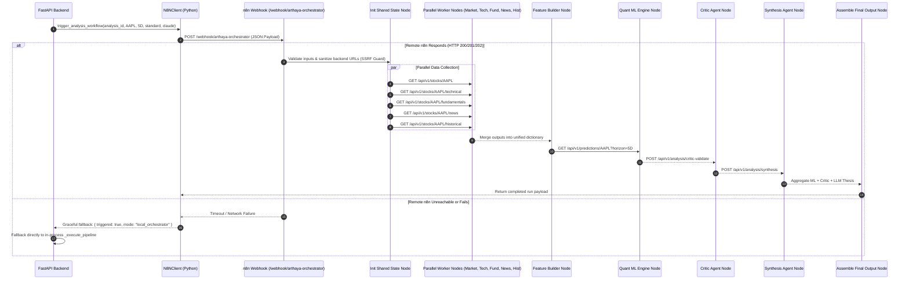
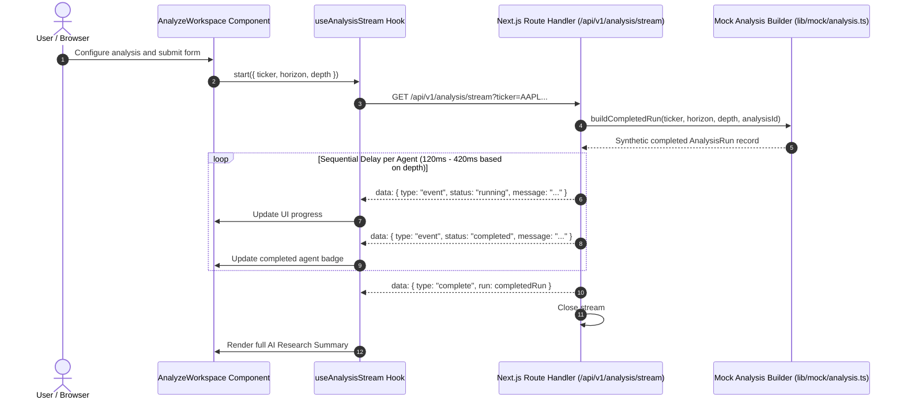

# Sequence Diagrams & Execution Choreography

## 1. End-to-End Analysis Lifecycle (FastAPI & Server-Sent Events)

This sequence diagram depicts the live execution lifecycle when an equity research run is started from the **Analyze Workspace** (`arthaya/src/app/(dashboard)/analyze/page.tsx`), demonstrating client-server interaction via HTTP POST and persistent Server-Sent Events (SSE):

```mermaid
sequenceDiagram
    autonumber
    actor Analyst as User / Browser
    participant UI as Next.js AnalyzeWorkspace
    participant Hook as useAnalysisStream (Hook)
    participant API as FastAPI Router (/api/v1)
    participant N8N as N8NClient / n8n Webhook
    participant Exec as _execute_pipeline
    participant Services as Domain Services (Market/Tech/etc.)
    participant DB as SQLite DB (AsyncSession)

    Analyst->>UI: Selects Ticker (e.g. AAPL), Horizon (5D), Depth, Provider
    Analyst->>UI: Clicks "Run Analysis"
    UI->>Hook: start({ ticker: "AAPL", horizon: "5D", depth: "standard" })
    
    rect rgb(15, 23, 42)
        Note over Hook,API: Persistent EventSource SSE Connection
        Hook->>API: GET /api/v1/analysis/{id}/stream?ticker=AAPL&horizon=5D
        API-->>Hook: 200 OK (text/event-stream)
    end

    loop For each of 9 Pipeline Agents
        API->>API: Executes stage simulation / delay
        API-->>Hook: data: { agent: "market", status: "completed", progress: 22, ... }
        Hook->>UI: Updates AgentTimeline & LiveExecutionLog
    end

    rect rgb(30, 41, 59)
        Note over API,Exec: Pipeline Execution & Data Aggregation
        API->>Exec: _execute_pipeline(AAPL, 5D, standard, claude, analysis_id)
        Exec->>Services: Fetch Market, Technical, Fundamental, News, Historical
        Services-->>Exec: Aggregated Data Dictionaries
        Exec->>Exec: FeatureBuilder.build_feature_vector (Cutoff Enforced)
        Exec->>Exec: MLEngine.predict (LR / RF / XGBoost Ensemble)
        Exec->>Exec: CriticService.validate (Quality & Leakage Checks)
        Exec->>Exec: ModelGateway.generate_synthesis (Claude / Gemini / etc.)
    end

    rect rgb(16, 185, 129, 0.15)
        Note over Exec,DB: Asynchronous Database Persistence
        Exec->>DB: INSERT AnalysisRun
        Exec->>DB: INSERT PredictionRecord
        Exec->>DB: INSERT ResearchReport
        DB-->>Exec: Commit OK
    end

    API-->>Hook: data: { status: "completed", run: { prediction, critic, summary } }
    Hook->>UI: Transition phase to "completed"
    UI-->>Analyst: Render PredictionCard, Confidence, and AIResearchSummary
    Hook->>API: Close EventSource Stream
```

---

## 2. Remote n8n Orchestrator Workflow Choreography

When a job is queued via `POST /api/v1/analysis`, the FastAPI server communicates with the deployed n8n workflow at `https://n8n.sushantkumaryadav.com.np`:

---

## 3. Standalone Frontend Demo Mode Sequence

When the frontend is executed in isolated demo mode (`NEXT_PUBLIC_DEMO_MODE=true`), the browser bypasses external server connections and runs entirely within Next.js:

