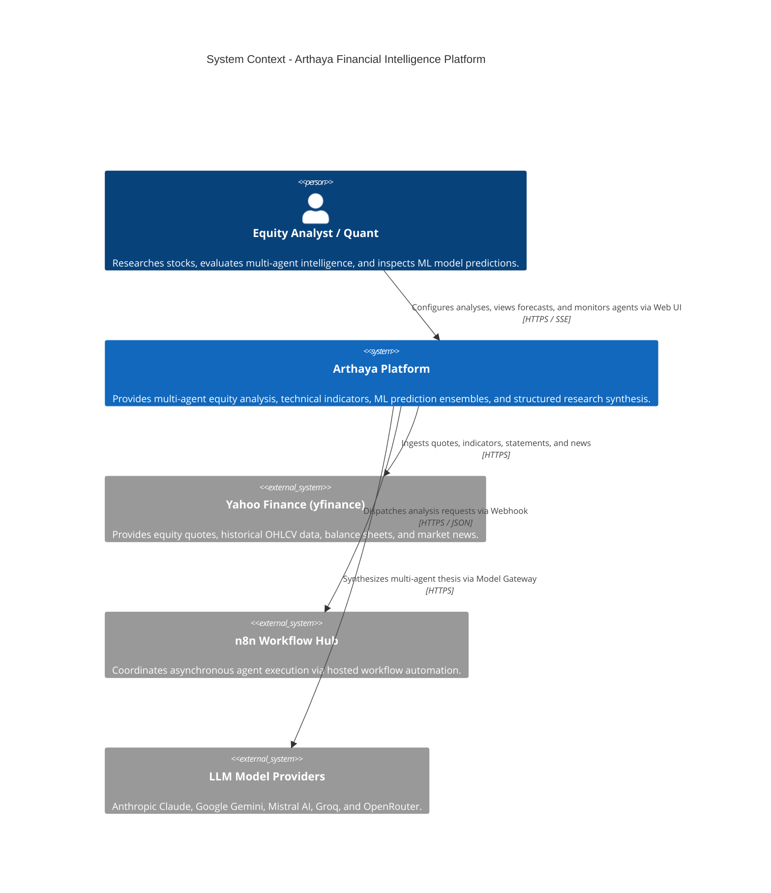
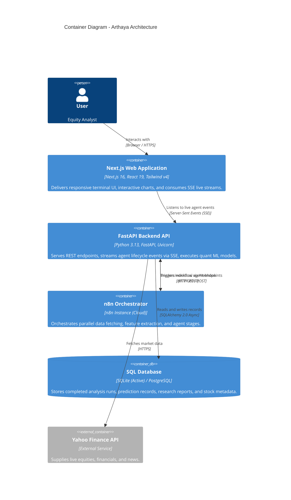
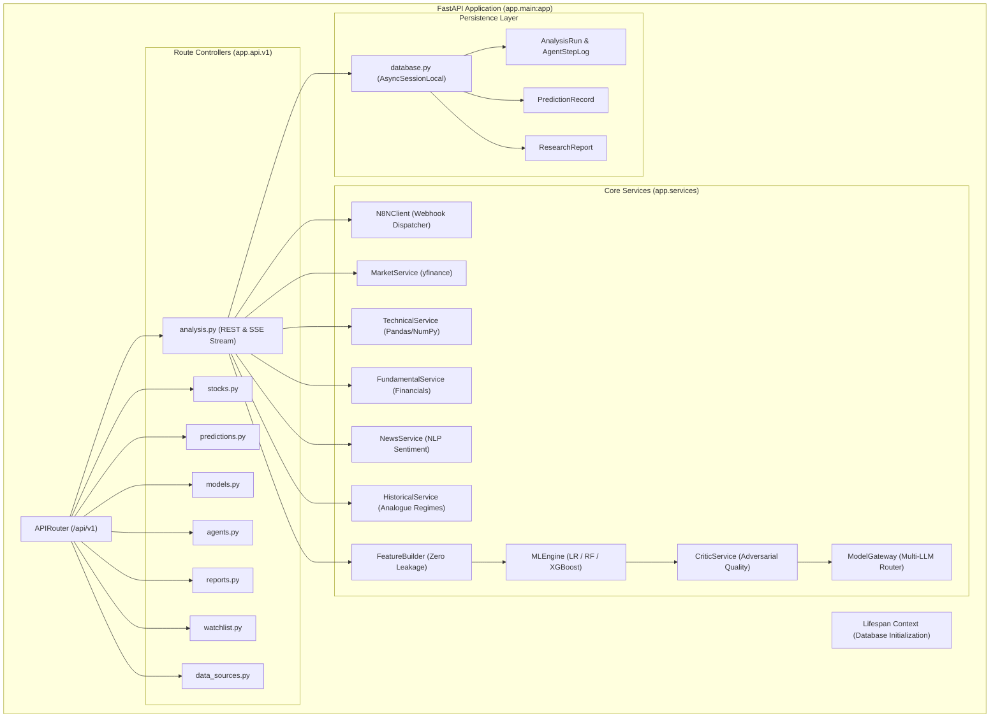

# System Architecture & Monorepo Topology

## 1. Monorepo Structural Overview

The **FinanceAgent (Arthaya)** project is structured as a multi-tier repository consisting of three core application domains and workspace configuration roots:

```text
FinanceAgent/
├── backend/                  # FastAPI Python backend engine & ML layer
│   ├── app/
│   │   ├── api/v1/          # REST & SSE route controllers
│   │   ├── models/          # SQLAlchemy 2.0 ORM database models
│   │   ├── schemas/         # Pydantic v2 validation contracts
│   │   ├── services/        # Quant, technical, and LLM services
│   │   ├── config.py        # Centralized settings & environment loading
│   │   ├── database.py      # Async SQLAlchemy engine & session factory
│   │   ├── main.py          # FastAPI application initialization & lifespan
│   │   └── test_run.py      # End-to-end integration validation script
│   ├── arthaya.db           # Active SQLite persistent database
│   ├── Dockerfile           # Python 3.13 container definition
│   └── requirements.txt     # Python dependencies
├── arthaya/                  # Next.js 16 App Router web frontend
│   ├── src/
│   │   ├── app/             # App Router layout and page hierarchy
│   │   │   ├── (auth)/      # Authentication route group (login, register)
│   │   │   ├── (dashboard)/ # Main dashboard views (12 distinct pages)
│   │   │   └── api/v1/      # Standalone Next.js route handlers (demo mode)
│   │   ├── components/      # UI component hierarchy (shadcn-inspired)
│   │   ├── hooks/           # Custom React hooks (SSE streaming, watchlist)
│   │   ├── lib/             # API client, types, constants, mock data
│   │   └── services/        # Auth and user service abstractions
│   ├── package.json         # Frontend dependencies & scripts
│   └── tsconfig.json        # TypeScript configuration
├── n8n/                      # Workflow automation & agent orchestration
│   ├── scripts/             # Python automation scripts (deploy_workflow.py)
│   └── workflows/           # Orchestrator JSON definitions (v1 and fixed)
├── project.md                # Original architectural specification prompt
└── docs/                     # Technical documentation suite
```

---

## 2. C4 Architecture Model

### Level 1: System Context Diagram



---

### Level 2: Container Diagram



---

### Level 3: Component Diagram (FastAPI Backend)



---

## 3. Communication Protocols & Boundaries

| Channel | Source | Destination | Protocol | Payload Format | Evidence in Code |
| :--- | :--- | :--- | :--- | :--- | :--- |
| **Client REST API** | Next.js Frontend | FastAPI Backend | HTTP/1.1 | JSON (`Accept: application/json`) | [client.ts:L8-34](file:///home/sushant/Projects/Agentic/FinanceAgent/arthaya/src/lib/api/client.ts#L8-L34) |
| **Live Stream** | FastAPI Backend | Next.js Frontend | Server-Sent Events | `text/event-stream` (SSE) | [analysis.py:L68-102](file:///home/sushant/Projects/Agentic/FinanceAgent/backend/app/api/v1/analysis.py#L68-L102), [useAnalysisStream.ts](file:///home/sushant/Projects/Agentic/FinanceAgent/arthaya/src/hooks/useAnalysisStream.ts) |
| **Workflow Trigger** | FastAPI Backend | n8n Orchestrator | HTTP POST Webhook | JSON (`X-N8N-API-KEY` if set) | [n8n_client.py:L16-46](file:///home/sushant/Projects/Agentic/FinanceAgent/backend/app/services/n8n_client.py#L16-L46) |
| **Agent Dispatches** | n8n Orchestrator | FastAPI Backend | HTTP GET / POST | JSON | [arthaya_analysis_orchestrator_fixed.json](file:///home/sushant/Projects/Agentic/FinanceAgent/n8n/workflows/arthaya_analysis_orchestrator_fixed.json) |
| **Market Ingestion** | FastAPI Backend | Yahoo Finance | HTTPS / TLS | JSON / Binary | `yfinance` internal network client |
| **Database I/O** | FastAPI Backend | SQLite / Postgres | Async DB-API | Binary / SQL | [database.py:L8-18](file:///home/sushant/Projects/Agentic/FinanceAgent/backend/app/database.py#L8-L18) |

---

## 4. Key Architectural Attributes

### 1. Dual-Path Execution Model
The system supports two independent execution paths:
- **Distributed Mode**: The Next.js frontend calls the FastAPI backend, which initiates the remote n8n orchestrator at `https://n8n.sushantkumaryadav.com.np`. The n8n orchestrator coordinates parallel calls back to the backend data agents and gathers the shared state.
- **Local Fallback Mode**: If n8n is unreachable, the backend's internal `_execute_pipeline` method executes the 9-stage sequence in-process, guaranteeing reliable execution without external orchestrator dependencies ([analysis.py:L145-223](file:///home/sushant/Projects/Agentic/FinanceAgent/backend/app/api/v1/analysis.py#L145-L223)).

### 2. Standalone Frontend Demo Mode
The Next.js frontend includes a complete client-side mock repository ([arthaya/src/lib/mock/](file:///home/sushant/Projects/Agentic/FinanceAgent/arthaya/src/lib/mock/)) and Next.js route handlers (`src/app/api/v1/`). When `NEXT_PUBLIC_DEMO_MODE=true` (the default), the frontend runs entirely in isolation without requiring the Python backend to be active.

### 3. Asynchronous Database Lifespan
Database tables are verified and initialized automatically on application startup via FastAPI's `lifespan` context manager using SQLAlchemy's async connection pool ([main.py:L9-24](file:///home/sushant/Projects/Agentic/FinanceAgent/backend/app/main.py#L9-L24)).
