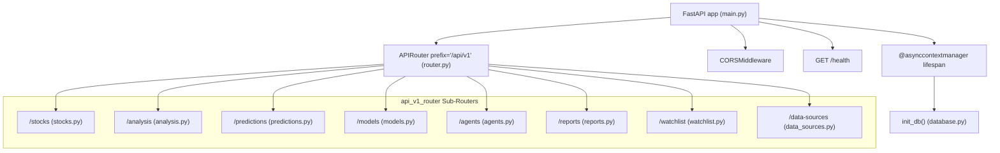

# Backend Architecture & Service Organization

## 1. FastAPI Application Design

The backend application is implemented in Python 3.13 using the **FastAPI** web framework. The application entry point is [backend/app/main.py](file:///home/sushant/Projects/Agentic/FinanceAgent/backend/app/main.py).

### Architectural Characteristics:
- **Asynchronous Lifespan Management**: Replaces legacy `@app.on_event("startup")` handlers with a modern Python `asynccontextmanager` (`lifespan`), ensuring deterministic startup initialization of database schemas.
- **Permissive Development CORS Middleware**: Configures `CORSMiddleware` with `allow_origins=["*"]`, `allow_credentials=True`, `allow_methods=["*"]`, and `allow_headers=["*"]` to accommodate development origins (`localhost:3000`, `127.0.0.1:3000`).
- **Hierarchical Routing**: Routes are modularized under `app.api.v1.router.api_v1_router` with prefix `/api/v1` ([backend/app/api/v1/router.py](file:///home/sushant/Projects/Agentic/FinanceAgent/backend/app/api/v1/router.py)).
- **Health Check Endpoint**: Root-level `GET /health` exposing backend operational status, orchestrator URLs, and service version ([main.py:L37-46](file:///home/sushant/Projects/Agentic/FinanceAgent/backend/app/main.py#L37-L46)).



---

## 2. Directory Layout & Module Structure

```text
backend/app/
├── api/
│   └── v1/
│       ├── agents.py         # Agent status query controller
│       ├── analysis.py       # Pipeline execution, SSE stream, critic & synthesis endpoints
│       ├── data_sources.py   # Data provider connection status
│       ├── models.py         # Backtest & validation model performance metrics
│       ├── predictions.py    # Direct ML prediction query endpoint
│       ├── reports.py        # Research report listing & detail retrieval
│       ├── router.py         # Central aggregator for all v1 sub-routers
│       ├── stocks.py         # Ticker overview, technical, fundamental, news, and historical endpoints
│       └── watchlist.py      # Watchlist items controller
├── models/
│   ├── __init__.py           # Model exports for Base.metadata registration
│   ├── analysis.py           # AnalysisRun and AgentStepLog ORM models
│   ├── prediction.py         # PredictionRecord and ModelPerformanceRecord ORM models
│   ├── report.py             # ResearchReport ORM model
│   ├── stock.py              # Stock master record ORM model
│   └── watchlist.py          # WatchlistItem ORM model
├── schemas/
│   ├── analysis.py           # Pydantic schemas for requests, SSE events, and synthesis
│   ├── prediction.py         # Pydantic schemas for model votes and prediction responses
│   └── stock.py              # Pydantic schemas for stocks, technicals, and fundamentals
├── services/
│   ├── critic_service.py     # Adversarial quality & signal agreement validator
│   ├── feature_builder.py    # 17-dimensional vector builder with timestamp cutoff
│   ├── fundamental_service.py# Corporate statements and ratio extraction
│   ├── historical_service.py # Historical regime matching and return distributions
│   ├── market_service.py     # Live quotes, exchange details, and global indices
│   ├── ml_engine.py          # Quantitative ML ensemble (LR, RF, XGBoost)
│   ├── model_gateway.py      # Multi-model LLM abstraction router
│   ├── n8n_client.py         # Async HTTP client for remote n8n orchestrator
│   ├── news_service.py       # News feed scraper and heuristic sentiment classifier
│   └── technical_service.py  # Mathematical technical indicator engine
├── config.py                 # Pydantic Settings loading environment variables
├── database.py               # Async SQLAlchemy engine and session factory
├── main.py                   # FastAPI application initialization
└── test_run.py               # Integration test script for end-to-end pipeline validation
```

---

## 3. Dependency Injection & Database Lifecycle

Database sessions are managed via asynchronous session factories in [backend/app/database.py](file:///home/sushant/Projects/Agentic/FinanceAgent/backend/app/database.py):

```python
engine = create_async_engine(
    settings.DATABASE_URL,
    echo=False,
    future=True
)

AsyncSessionLocal = async_sessionmaker(
    bind=engine,
    class_=AsyncSession,
    expire_on_commit=False
)
```

### Session Lifecycle Pattern:
1. Endpoints requiring database access utilize the `get_db()` async generator dependency.
2. Background pipeline executions (`_execute_pipeline`) construct explicit session contexts:
   ```python
   async with AsyncSessionLocal() as db:
       # Add AnalysisRun, PredictionRecord, ResearchReport
       await db.commit()
   ```
3. Automatic schema initialization executes on server startup in `lifespan`:
   ```python
   async def init_db():
       import app.models  # Ensures all models are registered on Base.metadata
       async with engine.begin() as conn:
           await conn.run_sync(Base.metadata.create_all)
   ```

---

## 4. In-Memory Analysis Cache

To support real-time progress polling and low-latency SSE stream initialization, [analysis.py](file:///home/sushant/Projects/Agentic/FinanceAgent/backend/app/api/v1/analysis.py) maintains an in-memory dictionary cache:

```python
ANALYSIS_CACHE: Dict[str, Dict[str, Any]] = {}
```

- When `POST /api/v1/analysis` is received, a unique analysis identifier (`ana_{hex_10}`) is generated and keyed in `ANALYSIS_CACHE` with status `"queued"`.
- When `GET /api/v1/analysis/{analysis_id}/stream` finishes running the pipeline, the final aggregated dictionary is cached under `ANALYSIS_CACHE[analysis_id]["run"]`.
- When subsequent requests query `GET /api/v1/analysis/{analysis_id}`, the cached result is returned immediately without recomputing the pipeline.
