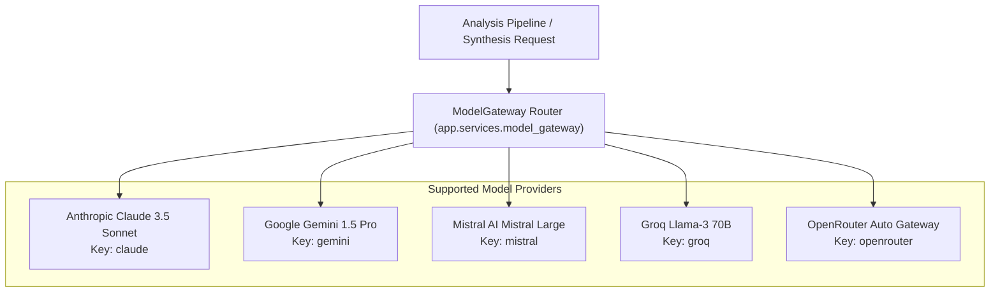

# Model Gateway & LLM Integration

## 1. Multi-Model Architecture

The **Model Gateway** ([backend/app/services/model_gateway.py](file:///home/sushant/Projects/Agentic/FinanceAgent/backend/app/services/model_gateway.py)) provides an abstraction layer over major Foundation Model providers. Rather than coupling prompt templates and inference code to a single vendor, the gateway supports configurable provider routing across commercial and open-weight models.



---

## 2. Provider Catalog & Registry

As defined in [model_gateway.py:L11-17](file:///home/sushant/Projects/Agentic/FinanceAgent/backend/app/services/model_gateway.py#L11-L17):

| Provider Key | Model Name | Vendor | Environment Variable | Primary Role |
| :--- | :--- | :--- | :--- | :--- |
| `claude` | Claude 3.5 Sonnet | Anthropic | `ANTHROPIC_API_KEY` | Default synthesis engine; deep analytical nuance and reasoning. |
| `gemini` | Gemini 1.5 Pro | Google | `GEMINI_API_KEY` | High-context quantitative reconciliation. |
| `mistral` | Mistral Large | Mistral AI | `MISTRAL_API_KEY` | Concise European and multi-jurisdictional perspective. |
| `groq` | Llama 3 70B (Groq) | Groq | `GROQ_API_KEY` | Ultra-low latency inference for live streaming. |
| `openrouter` | Auto Router | OpenRouter | `OPENROUTER_API_KEY` | Fallback router across diverse hosted models. |

---

## 3. Structured Synthesis Contract

The gateway compiles structured inputs from all preceding agents into an explainable, cited research thesis.

### Synthesis Method Signature:
```python
@classmethod
async def generate_synthesis(
    cls,
    provider: str,
    ticker: str,
    market_data: Dict[str, Any],
    technical_data: Dict[str, Any],
    fundamental_data: Dict[str, Any],
    news_data: Dict[str, Any],
    prediction_data: Dict[str, Any],
    critic_data: Dict[str, Any]
) -> Dict[str, Any]:
```

### Generated Schema:
```json
{
  "overall_signal": "UP",
  "probability": 0.68,
  "horizon_days": 5,
  "confidence": "Medium-High",
  "market_context": "AAPL trades at $224.50 (+1.25%) with market cap of $3450.0B.",
  "technical_view": "Real-time technical calculation for AAPL: RSI-14 at 62.4...",
  "fundamental_view": "Fundamental analysis for AAPL: Revenue stands at $385.0B with net income of $97.0B...",
  "news_view": "Web news sentiment score for AAPL: 0.68 (Positive)...",
  "historical_context": "Historical regime matching suggests +2.05% expected 5-day return across 75% positive historical outcomes.",
  "model_prediction": "XGBoost outputs 68% probability for positive 5-day trajectory.",
  "risk_factors": [
    "Macroeconomic interest rate sensitivity",
    "Valuation multiples (P/E 31.4x) near upper historical band"
  ],
  "conflicting_signals": [
    "Short-term RSI is elevated (62.4) relative to 30-day moving average.",
    "Regulatory policy news introduces tail-risk volatility."
  ],
  "data_quality": "High confidence — 92% data freshness. Synthesized via Model Gateway (Claude 3.5 Sonnet).",
  "agreement": {
    "technical": "positive",
    "fundamental": "neutral",
    "news": "positive",
    "historical": "positive",
    "mlModel": "positive"
  }
}
```

---

## 4. Current Implementation Status vs. Production Roadmap

- **Current Implementation**: The synthesis generator constructs explainable qualitative narratives from upstream agent outputs using standardized formatting templates and provider metadata attribution.
- **API Configuration**: API keys (`ANTHROPIC_API_KEY`, `GEMINI_API_KEY`, etc.) are declared in `app.config.Settings` and loaded via `.env`.
- **Roadmap / Outbound Integration**: In a production deployment with active paid credentials, outbound HTTP calls (via `httpx.AsyncClient`) can be routed directly to provider completion APIs (e.g., `https://api.anthropic.com/v1/messages`).
