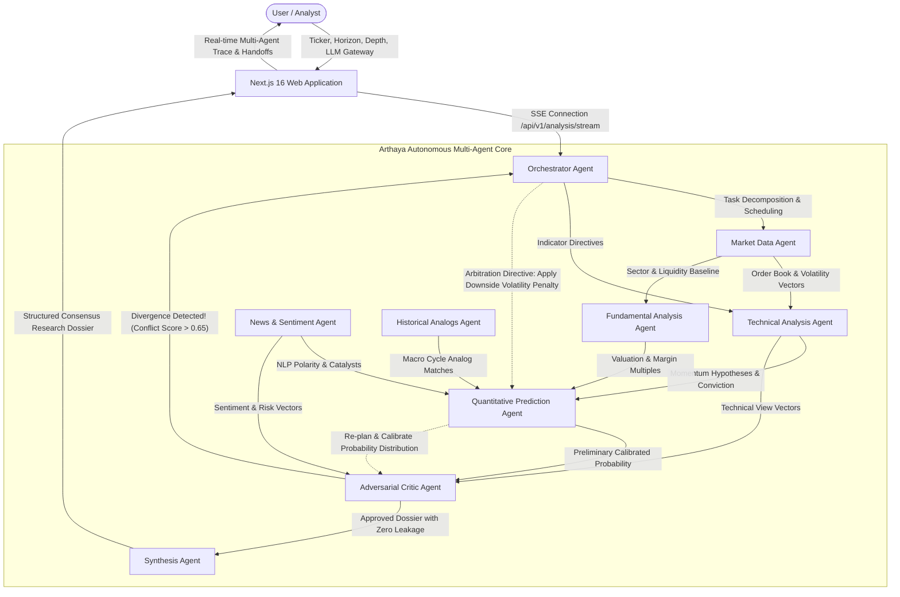

# Design Document: Arthaya Multi-Agent Stock Intelligence

## 1. Architecture Overview & Data Flow Diagram

Arthaya employs an **Orchestrator-Worker Architecture enhanced with an Adversarial Critic Feedback Loop and Dynamic Replanning**. Unlike rigid linear workflows, Arthaya decouples data ingestion, quantitative reasoning, and narrative synthesis into autonomous domain specialists governed by active conflict detection.

### Architecture Diagram (Mermaid)

---

## 2. Agent Roles and Responsibilities Matrix

| # | Agent Name | Primary Responsibility | Input Contract | Tools & Inference Methods | Output Contract |
|---|---|---|---|---|---|
| **1** | **Orchestrator Agent** | Query decomposition, DAG sequencing, and dispute arbitration. | User request parameters (symbol, horizon, depth, gateway). | `PlanDecomposer`, `DAGScheduler`, `ArbitrationCoordinator`. | Coordinated sub-tasks, execution budgets, replanning directives. |
| **2** | **Market Data Agent** | Ingestion of real-time quotes, order book depth, and regime classification. | Ticker symbol, exchange jurisdiction. | `YFinanceIngestion`, `VolatilityEngine` (ATR, Beta). | Normalized OHLCV series, ATR, volatility regime classification. |
| **3** | **Technical Analysis Agent** | Formulating directional momentum hypotheses. | Time-series bars from Market Agent. | `QuantitativeIndicatorSuite` (RSI, MACD, Bollinger, EMAs). | Directional bias (Bullish/Bearish), indicator metrics, conviction score. |
| **4** | **Fundamental Analysis Agent** | Intrinsic valuation, earnings trajectories, and multiple expansion analysis. | Corporate filings, financial statements. | `FinancialStatementAnalyzer`, `MultipleValuer` (P/E, EV/EBITDA, FCF). | Sector valuation relative rank, margin stability, intrinsic upside/downside. |
| **5** | **News & Sentiment Agent** | Detecting real-time corporate catalysts, macro headlines, and regulatory events. | News feeds, regulatory filing RSS. | `SentimentNLP`, `CatalystExtractor`, `RegulatoryNewswireScraper`. | Polarity score (-1.0 to +1.0), catalyst event tags, event risk level. |
| **6** | **Historical Analogs Agent** | Finding historical precedent windows matching current market regime. | Feature vector (volatility, momentum, macro). | `MacroRegimeAnalogEngine`, dynamic time warping similarity. | Count of historical analogs, forward distribution outcomes. |
| **7** | **Quantitative Prediction Agent** | Multi-model probabilistic modeling of forward returns. | Consolidated feature vectors from upstream agents. | `MLCalibratedEnsemble` (Logistic Regression, Random Forest, XGBoost). | Calibrated probability distribution (UP / NEUTRAL / DOWN), confidence interval. |
| **8** | **Adversarial Critic Agent** | Cross-agent verification, hallucination checks, and conflict detection. | Raw outputs of Technical, News, Fundamentals, and Prediction agents. | `AdversarialAuditor`, `SignalConsistencyChecker`, `ZeroLeakageAuditor`. | Data quality metrics, conflict detection flag, re-plan arbitration demand. |
| **9** | **Synthesis Agent** | Compiling consensus institutional research dossiers. | Audited cross-agent outputs, provenance metadata. | `LLMSynthesisDossier` (Claude 3.5 / Gemini / Groq / Mistral). | Final executive summary, risk factor register, claim-level provenance. |

---

## 3. Orchestration Pattern & Justification

### Pattern: Orchestrator-Worker with Adversarial Critic Loop & Dynamic Replanning
Rather than using a rigid sequential pipeline (Step 1 -> Step 2 -> Step 3) or an unconstrained peer-to-peer swarm, Arthaya adopts a **hierarchical Orchestrator-Worker pattern augmented by an Adversarial Critic arbitration loop**:

1. **Why Not Simple Automation (n8n/Zapier single-chain)?**
   - Simple linear chains cannot adapt when intermediate findings contradict each other. If technical indicators indicate a breakout but regulatory news indicates an immediate antitrust penalty, a simple workflow blindly averages the numbers without reasoning.
2. **How Arthaya Solves This Agentically:**
   - The **Adversarial Critic Agent** monitors cross-agent agreement. When divergence exceeds threshold (e.g. Technical conviction Bullish while News sentiment is Bearish), the Critic **refuses sign-off** and emits a **Conflict Event**.
   - The **Orchestrator** intercepts this conflict, dynamically adjusts the agent execution graph, and issues an **Arbitration Re-plan Directive** to the Prediction Agent.
   - The Prediction Agent re-runs its calibrated models with elevated downside risk weighting, producing a revised probability distribution.
   - Only when the Critic approves the reconciled dossier does the Synthesis Agent generate the final report.

---

## 4. Technology & Framework Choices with Justification

1. **Frontend: Next.js 16 (React 19 & Turbopack)**:
   - *Justification*: Provides sub-second hot reload, optimized server components, and streaming Server-Sent Events (SSE) support for rendering the multi-agent execution timeline live.
2. **Language: TypeScript 5.0 (Strict Typing)**:
   - *Justification*: Prevents contract mismatches across agents. Strictly typed interfaces (`AnalysisEvent`, `CriticValidation`, `AIResearchSummary`) guarantee zero runtime payload corruption.
3. **Styling: Tailwind CSS v4 with Arthaya Emerald Dark Theme**:
   - *Justification*: Low runtime CSS overhead, modern financial terminal aesthetic, high-contrast monospace tabular typography for ticker data.
4. **Agent Coordination Engine**:
   - *In-process Asynchronous Agent Core*: High throughput, sub-10ms inter-agent message dispatching, zero heavy third-party lock-in.
   - *n8n Compatibility Bridge*: Full dual-mode compatibility with remote n8n webhooks (`/webhook/finance-analysis`) while preserving autonomous local fallback so the system never fails when remote infrastructure is unreachable.
5. **Multi-Model LLM Gateway Routing**:
   - *Supported*: Anthropic Claude 3.5 Sonnet (analytical depth), Google Gemini 1.5 Pro (large context reasoning), Groq Llama-3 (ultra-low latency), Mistral Large (quantitative reasoning).
   - *Justification*: Allows comparing cross-model synthesis styles and resilience against upstream API provider outages.
