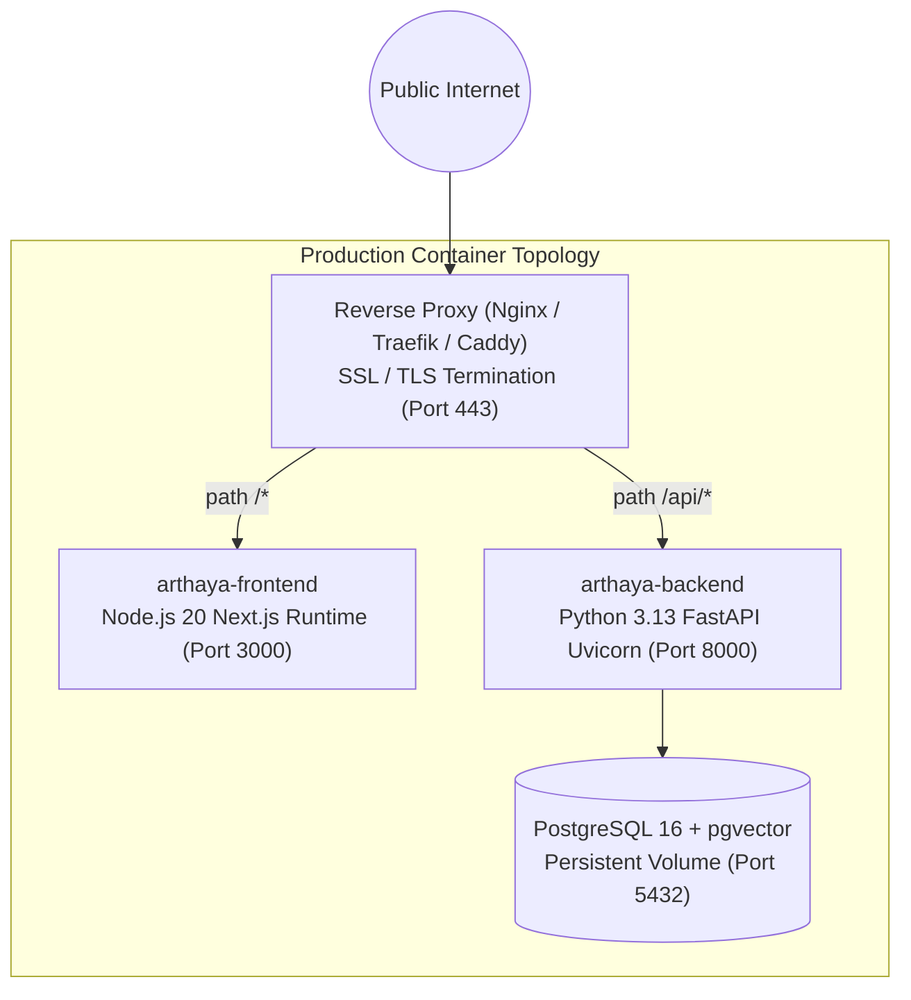

# Docker & Containerization

## 1. Backend Dockerfile Architecture

The backend engine includes a production-ready container definition in [backend/Dockerfile](file:///home/sushant/Projects/Agentic/FinanceAgent/backend/Dockerfile):

```dockerfile
FROM python:3.13-slim

WORKDIR /app

# Install system dependencies
RUN apt-get update && apt-get install -y --no-install-recommends \
    build-essential \
    libpq-dev \
    curl \
    && rm -rf /var/lib/apt/lists/*

COPY requirements.txt .
RUN pip install --no-cache-dir -r requirements.txt

COPY . .

EXPOSE 8000

CMD ["uvicorn", "app.main:app", "--host", "0.0.0.0", "--port", "8000"]
```

### Key Decisions:
- **Base Image**: `python:3.13-slim` provides a minimal Debian environment with low CVE surface area while maintaining binary compatibility with compiled C-extensions (NumPy, Scikit-Learn, XGBoost).
- **System Tooling**: Installs `build-essential` and `libpq-dev` for native PostgreSQL compilation (`psycopg2-binary`, `asyncpg`).
- **Layer Caching**: Copies `requirements.txt` independently prior to application code to leverage Docker build layer caching.
- **Port Exposure**: Exposes port `8000` for ASGI HTTP traffic.

---

## 2. Building & Running the Backend Container

### Build Image:
```bash
cd backend
docker build -t arthaya-backend:latest .
```

### Run Container (with SQLite Persistence):
```bash
docker run -d \
  --name arthaya-api \
  -p 8000:8000 \
  -v $(pwd)/arthaya.db:/app/arthaya.db \
  --env-file .env \
  arthaya-backend:latest
```

### Health Verification:
```bash
curl -f http://localhost:8000/health
```

---

## 3. Recommended Production Multi-Container Topology

In production environments, the platform can be deployed via a container orchestrator (Docker Compose, Kubernetes, or ECS) using three containers:


