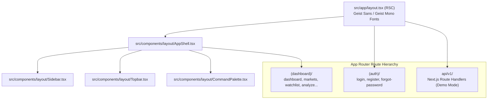

# Frontend Architecture & Component Hierarchy

## 1. Next.js 16 & React 19 Foundation

The frontend application (`arthaya/`) is engineered using **Next.js 16.3.6 (App Router)** and **React 19.2.8** ([arthaya/package.json](file:///home/sushant/Projects/Agentic/FinanceAgent/arthaya/package.json)).

### Architectural Principles:
1. **Server-First by Default**: Pages under `src/app/(dashboard)/` execute as React Server Components (RSC) to minimize client-side bundle size, fetching initial data on the server.
2. **Targeted Client Component Boundaries**: Interactive capabilities—such as the Server-Sent Events analysis driver (`AnalyzeWorkspace.tsx`), chart interactions, command palette (`CommandPalette.tsx`), and local watchlist management (`useWatchlist.ts`)—are encapsulated with `"use client"`.
3. **Dual Execution Runtime**: The frontend seamlessly transitions between an offline demo repository (`src/lib/mock/`) and live backend communication depending on the `NEXT_PUBLIC_DEMO_MODE` environment variable.



---

## 2. Directory Layout & Module Structure

```text
arthaya/src/
├── app/
│   ├── (auth)/               # Auth route group
│   │   ├── layout.tsx        # Auth shell layout (split branding panel)
│   │   ├── login/page.tsx    # Sign in view
│   │   ├── register/page.tsx # Account registration view
│   │   └── forgot-password/  # Password reset flow view
│   ├── (dashboard)/          # Dashboard route group
│   │   ├── layout.tsx        # Persistent AppShell wrapper
│   │   ├── dashboard/        # Market Overview & recent analyses
│   │   ├── markets/          # Global index benchmarks (US & India)
│   │   ├── watchlist/        # Tracked equities with localStorage
│   │   ├── analyze/          # Live Multi-Agent Workspace (SSE driven)
│   │   ├── predictions/      # Ensemble Model Probabilities
│   │   ├── agents/           # Agent pipeline graph and status
│   │   ├── compare/          # Multi-ticker comparison matrix
│   │   ├── reports/          # Synthesized research reports
│   │   ├── data-sources/     # Data provider connectivity matrix
│   │   ├── models/           # Backtest & walk-forward performance
│   │   ├── settings/         # App preferences and mode toggles
│   │   └── stocks/[ticker]/  # Deep-dive multi-tab ticker sub-routes
│   ├── api/v1/               # Standalone Next.js Route Handlers (Demo Mode)
│   ├── globals.css           # Tailwind v4 theme & global styles
│   └── layout.tsx            # Global HTML root layout
├── components/
│   ├── agents/               # AgentCard, AgentGraph
│   ├── analysis/             # AnalyzeWorkspace, AgentTimeline, AIResearchSummary, DataQualityCard
│   ├── auth/                 # AuthForm (Zod & React Hook Form)
│   ├── charts/               # PriceChart, CandlestickChart, Sparkline, ProbabilityBar
│   ├── common/               # ProvenanceTag, StatusBadge, ValueDelta, States, Headings
│   ├── layout/               # AppShell, Sidebar, Topbar, StockSearch, CommandPalette
│   ├── models/               # ModelPerformanceTable, WalkForwardTimeline, BaselineComparison
│   ├── predictions/          # PredictionCard, ModelBreakdown
│   ├── reports/              # ReportCard, ReportDetail
│   ├── stocks/               # StockTable, StockHeader, StockTabs, MetricCard, NewsCard
│   └── ui/                   # Button, Card, Badge, Input, Table, Tabs, Skeleton
├── hooks/
│   ├── useAnalysisStream.ts  # SSE EventSource analysis consumer
│   ├── useCommandPalette.tsx # Global keyboard shortcut listener
│   ├── useMediaQuery.ts      # Responsive viewport hook
│   └── useWatchlist.ts       # LocalStorage synchronized watchlist hook
├── lib/
│   ├── api/                  # REST API client & typed endpoints
│   ├── constants/            # Navigation items, agent pipeline definitions
│   ├── mock/                 # In-memory mock repositories for demo mode
│   ├── types/                # Strict TypeScript domain model interfaces
│   └── utils/                # Formatting, Tailwind merge (cn), environment flags
└── services/
    ├── authService.ts        # Pluggable AuthProvider abstraction (Cognito-ready)
    └── userService.ts        # User profile mock service
```

---

## 3. Server vs. Client Component Boundaries

| Component | Nature | Rationale |
| :--- | :--- | :--- |
| `src/app/(dashboard)/dashboard/page.tsx` | Server (RSC) | Fetches market indices, intelligence, watchlist, and predictions concurrently via `Promise.all` before HTML streaming. |
| `src/app/(dashboard)/markets/page.tsx` | Server (RSC) | Static rendering of index groups (US & India) with server-rendered data tables. |
| `src/app/(dashboard)/agents/page.tsx` | Server (RSC) | Pre-renders the agent pipeline layout and static topology on the server. |
| `src/components/analysis/AnalyzeWorkspace.tsx`| Client (`"use client"`) | Manages form state, user input parameters, and subscribes to real-time SSE stream events. |
| `src/hooks/useAnalysisStream.ts` | Client (`"use client"`) | Establishes browser `EventSource` connections and manages streaming lifecycle states (`idle`, `running`, `completed`, `failed`). |
| `src/components/layout/CommandPalette.tsx` | Client (`"use client"`) | Listens for global `Ctrl+K`/`Cmd+K` keystrokes and controls dialog open state. |
| `src/components/stocks/ComparisonTable.tsx` | Client (`"use client"`) | Manages interactive symbol selection pills and dynamic column rendering for up to 5 tickers. |
| `src/components/auth/AuthForm.tsx` | Client (`"use client"`) | Interacts with React Hook Form and Zod validation schema on user typing. |

---

## 4. UI Primitive Design & Accessibility

The UI layer implements custom primitives styled using Tailwind CSS v4 in `src/components/ui/`:
- **Card**: Supports `variant="default"` and `variant="instrument"` (higher elevation with subtle emerald glow border).
- **Badge**: Configurable with financial semantic tones (`positive`, `negative`, `warning`, `neutral`).
- **Button**: Supports `variant="glow"` (subtle emerald illumination) for primary calls to action.
- **Table & Skeleton**: Fully accessible semantic tables and loading states designed for financial terminal data density.
