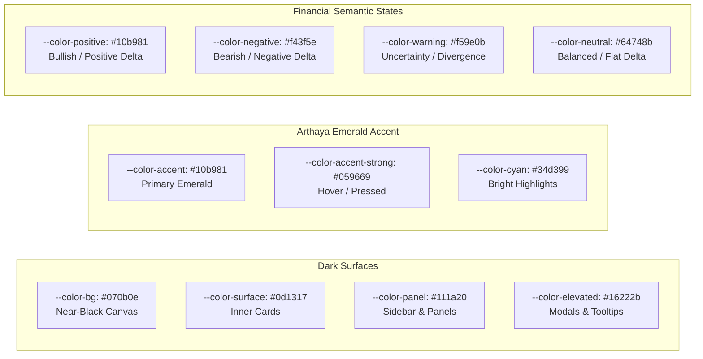

# Design System, Typography & UI Tokens

## 1. Visual Language & Brand Tokens

The design system for **Arthaya** is customized for high information density, dark-first institutional terminals, and clear signal readability ([arthaya/src/app/globals.css](file:///home/sushant/Projects/Agentic/FinanceAgent/arthaya/src/app/globals.css)).



---

## 2. Complete Design Token Specification

### Color Tokens (Tailwind CSS v4 `@theme`)

```css
@theme {
  /* Surfaces */
  --color-bg: #070b0e;
  --color-surface: #0d1317;
  --color-panel: #111a20;
  --color-elevated: #16222b;

  /* Precision Hairline Borders */
  --color-border: #1e2c36;
  --color-border-strong: #2a3c4a;

  /* Typography Contrast */
  --color-fg: #f1f5f9;
  --color-fg-muted: #94a3b8;
  --color-fg-subtle: #58697a;

  /* Arthaya Emerald Accent */
  --color-accent: #10b981;
  --color-accent-strong: #059669;
  --color-accent-soft: rgba(16, 185, 129, 0.12);
  --color-accent-glow: rgba(16, 185, 129, 0.25);
  --color-cyan: #34d399;

  /* Directional Semantics */
  --color-positive: #10b981;
  --color-positive-soft: rgba(16, 185, 129, 0.15);
  --color-negative: #f43f5e;
  --color-negative-soft: rgba(244, 63, 94, 0.15);
  --color-warning: #f59e0b;
  --color-warning-soft: rgba(245, 158, 11, 0.15);
  --color-neutral: #64748b;

  /* Radii */
  --radius-sm: 0.25rem;
  --radius-md: 0.375rem;
  --radius-lg: 0.625rem;
  --radius-xl: 0.875rem;

  /* Typography */
  --font-sans: var(--font-text);
  --font-display: var(--font-display);
  --font-mono: var(--font-instrument-mono);
}
```

---

## 3. Typography Rules

As specified in project standards, typography enforces strict legibility and visual hierarchy:
- **Proportional Text (Geist Sans)**: Applied to general body copy, headings, descriptions, and executive summaries.
- **Monospace Text (SFMono / Menlo / Liberation Mono)**: Specifically designated via the `.tabular` utility class for:
  - Equity price levels (`$224.50`)
  - Percentage changes (`+1.25%`, `-0.40%`)
  - Timestamps and execution clocks (`00:03`)
  - Ticker symbols (`AAPL`, `NVDA`)
  - ML confidence and probability figures (`0.68`)
  - Quantitative technical indicators (`RSI-14: 62.4`)

---

## 4. Provenance & Attribution Tags

To maintain analytical transparency, the platform implements standardized provenance tags ([src/components/common/ProvenanceTag.tsx](file:///home/sushant/Projects/Agentic/FinanceAgent/arthaya/src/components/common/ProvenanceTag.tsx)):

| Tag Kind | Display Label | Tone | Meaning |
| :--- | :--- | :--- | :--- |
| `market-data` | Market Data | `neutral` | Live or historical exchange data from primary market feeds. |
| `indicator` | Calculated Indicator | `neutral` | Deterministic mathematical indicators (RSI, MACD, etc.). |
| `ml-prediction` | ML Prediction | `accent` | Probabilistic output from the quantitative model ensemble. |
| `ai-interpretation`| AI Interpretation | `accent` | Generative thesis synthesized by Model Gateway LLMs. |
| `backtest` | Backtested Performance| `warning` | Historical simulation results—not a future guarantee. |

---

## 5. Chart Theming & Financial Visualizations

All interactive charts in `src/components/charts/` adhere to the centralized palette defined in `chartTheme.tsx` ([chartTheme.tsx](file:///home/sushant/Projects/Agentic/FinanceAgent/arthaya/src/components/charts/chartTheme.tsx)):
- **Grid Lines**: Hairline low-contrast strokes (`#1e2c36`, dashed `3 3`).
- **Candlestick Colors**: Emerald green (`#10b981`) for bullish bars; Rose red (`#f43f5e`) for bearish bars.
- **Sparklines**: Ultra-compact 36px SVG lines with gradient fills matching price trajectory.
- **Tooltips**: Semi-opaque elevated slate background (`#16222b`) with high-contrast tabular typography.
