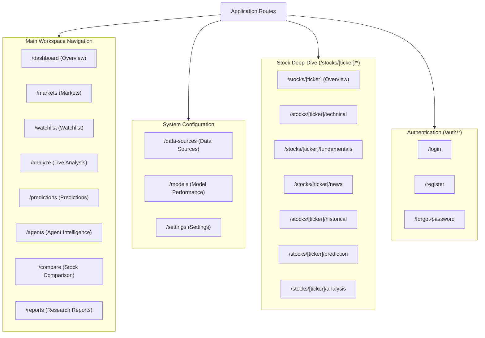

# Routes & Views Reference

## 1. Application Navigation Structure

The platform navigation hierarchy is defined in [arthaya/src/lib/constants/nav.ts](file:///home/sushant/Projects/Agentic/FinanceAgent/arthaya/src/lib/constants/nav.ts):

---

## 2. Core Dashboard Views

### 1. Market Overview (`/dashboard`)
- **File**: [arthaya/src/app/(dashboard)/dashboard/page.tsx](file:///home/sushant/Projects/Agentic/FinanceAgent/arthaya/src/app/%28dashboard%29/dashboard/page.tsx)
- **Role**: Executive operational cockpit.
- **Components**:
  - Top Index Banner: Sparklines and price deltas for S&P 500, NASDAQ, NIFTY 50, and SENSEX.
  - Watchlist Snapshot: Compact preview of pinned symbols.
  - AI Market Intelligence: Real-time macro regime assessment (`Momentum`, `Volatility`, `News Sentiment`).
  - Recent AI Analyses: Cards linking to completed multi-agent research dossiers.
  - Prediction Snapshot: Grid of top 5-day probabilistic forecasts.

---

### 2. Live Analysis Workspace (`/analyze`)
- **File**: [arthaya/src/app/(dashboard)/analyze/page.tsx](file:///home/sushant/Projects/Agentic/FinanceAgent/arthaya/src/app/%28dashboard%29/analyze/page.tsx)
- **Role**: Interactive multi-agent pipeline control center.
- **Key Features**:
  - Configuration Bar: Select ticker, forecast horizon (`1D`, `5D`, `20D`), pipeline depth (`quick`, `standard`, `deep`), and Model Gateway provider.
  - Live Agent Timeline: Visual sequencing showing status (`idle`, `running`, `completed`) for all 9 agents.
  - Live Execution Log: Chronological stream of tasks emitted over Server-Sent Events.
  - Results Inspection: Renders `PredictionCard`, `ModelBreakdown`, `DataQualityCard`, and comprehensive `AIResearchSummary`.

---

### 3. Markets (`/markets`)
- **File**: [arthaya/src/app/(dashboard)/markets/page.tsx](file:///home/sushant/Projects/Agentic/FinanceAgent/arthaya/src/app/%28dashboard%29/markets/page.tsx)
- **Role**: Cross-market benchmark comparison covering US indices and Indian exchanges with sparklines.

---

### 4. Watchlist (`/watchlist`)
- **File**: [arthaya/src/app/(dashboard)/watchlist/page.tsx](file:///home/sushant/Projects/Agentic/FinanceAgent/arthaya/src/app/%28dashboard%29/watchlist/page.tsx)
- **Role**: Symbol monitoring tracked client-side via `localStorage`. Allows adding custom tickers and removing tracked rows dynamically.

---

### 5. Prediction Engine (`/predictions`)
- **File**: [arthaya/src/app/(dashboard)/predictions/page.tsx](file:///home/sushant/Projects/Agentic/FinanceAgent/arthaya/src/app/%28dashboard%29/predictions/page.tsx)
- **Role**: Global catalog of quantitative machine learning forecasts across all supported symbols with horizon filtering (`1D`, `5D`, `20D`).

---

### 6. Agent Intelligence (`/agents`)
- **File**: [arthaya/src/app/(dashboard)/agents/page.tsx](file:///home/sushant/Projects/Agentic/FinanceAgent/arthaya/src/app/%28dashboard%29/agents/page.tsx)
- **Role**: Topological visualization of the agent DAG (`AgentGraph.tsx`), pipeline documentation, and individual `AgentCard` status monitors.

---

### 7. Stock Comparison Tool (`/compare`)
- **File**: [arthaya/src/app/(dashboard)/compare/page.tsx](file:///home/sushant/Projects/Agentic/FinanceAgent/arthaya/src/app/%28dashboard%29/compare/page.tsx)
- **Role**: Side-by-side metric comparison across 2 to 5 equities. Displays market metrics, P/E multiples, RSI-14, and model probabilities side-by-side without declaring an automated winner.

---

### 8. Research Reports (`/reports` and `/reports/[id]`)
- **File**: `arthaya/src/app/(dashboard)/reports/page.tsx`, `[id]/page.tsx`
- **Role**: Long-form synthesized institutional research reports rendered with Markdown, source citations, risk factor sections, and signal agreements.

---

### 9. System Views
- **Data Sources (`/data-sources`)**: Transparency view documenting the origin and operational state of each data type (yfinance, SEC EDGAR, n8n Orchestrator, Model Gateway).
- **Model Performance (`/models`)**: Statistical backtest reporting covering accuracy, precision, recall, F1, ROC-AUC, Brier score, log loss, walk-forward validation folds, and baseline comparisons.
- **Settings (`/settings`)**: Environment settings, demo vs. live backend mode badge, and platform disclosures.

---

## 3. Stock Detail Sub-Routes (`/stocks/[ticker]/*`)

Each equity ticker possesses a persistent multi-tab header shell ([StockHeader.tsx](file:///home/sushant/Projects/Agentic/FinanceAgent/arthaya/src/components/stocks/StockHeader.tsx)) and sub-routes:

| Sub-Route | Title | Content Focus |
| :--- | :--- | :--- |
| `/stocks/[ticker]` | Overview | Interactive Candlestick price chart, quick stats, volume, market cap. |
| `/stocks/[ticker]/technical` | Technical Analysis | Detailed indicators: RSI-14, SMAs (20/50/200), MACD, ATR-14, Bollinger Bands. |
| `/stocks/[ticker]/fundamentals`| Fundamentals | Financial statements, valuation multiples, ROE, ROA, Debt/Equity, FCF. |
| `/stocks/[ticker]/news` | News & Sentiment | Web news articles, sentiment score, event tagging (Earnings, Regulatory, etc.). |
| `/stocks/[ticker]/historical` | Historical Analogs | Regime similarity matching, analogue dates, forward returns. |
| `/stocks/[ticker]/prediction` | ML Prediction | Direction forecast, model breakdown votes (LR, RF, XGBoost). |
| `/stocks/[ticker]/analysis` | AI Analysis | Complete qualitative research synthesis and adversarial critic audit. |
