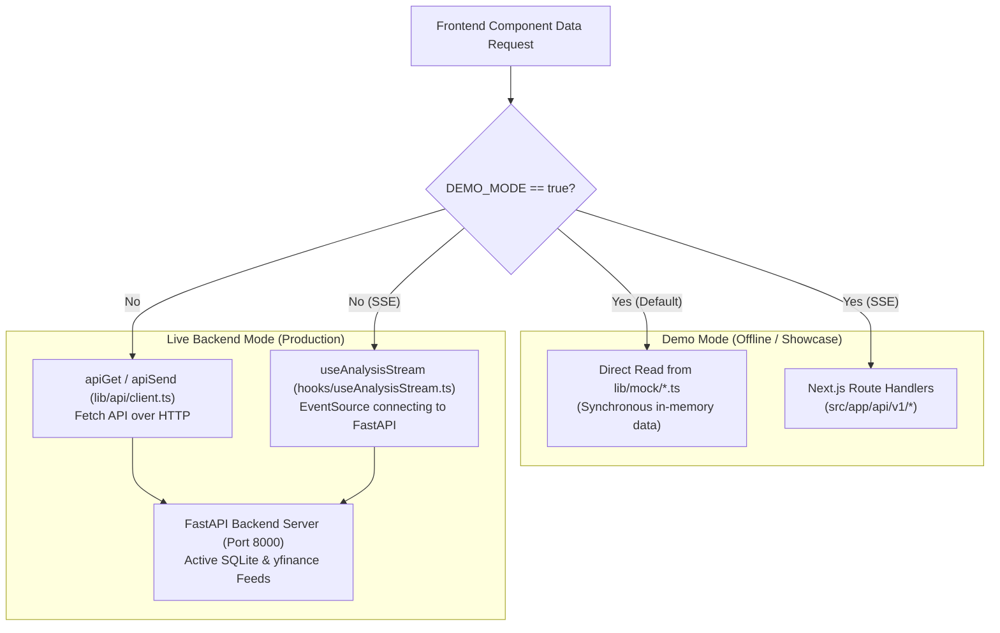

# State Management & Data Fetching Architecture

## 1. Dual-Mode Execution Architecture

The frontend is architected to operate in two distinct modes controlled by the `NEXT_PUBLIC_DEMO_MODE` environment variable ([arthaya/src/lib/utils/env.ts](file:///home/sushant/Projects/Agentic/FinanceAgent/arthaya/src/lib/utils/env.ts)):



### Mode Comparison:
| Mode | `NEXT_PUBLIC_DEMO_MODE` | API Client Behavior | Analysis Stream Behavior |
| :--- | :--- | :--- | :--- |
| **Demo Mode** (Default) | `"true"` | API modules read directly from in-memory mock repositories (`src/lib/mock/`). | EventSource connects to Next.js route handler (`/api/v1/analysis/stream`). |
| **Live Mode** | `"false"` | Performs HTTP network fetches to `${API_BASE}/api/v1/*` via `apiGet`/`apiSend`. | EventSource connects to FastAPI SSE endpoint (`http://localhost:8000/api/v1/analysis/stream`). |

---

## 2. Live Analysis Streaming Hook (`useAnalysisStream`)

The [useAnalysisStream.ts](file:///home/sushant/Projects/Agentic/FinanceAgent/arthaya/src/hooks/useAnalysisStream.ts) hook manages the real-time Server-Sent Events lifecycle:

### State Model:
- `phase`: `"idle" | "running" | "completed" | "failed"`
- `events`: Array of received `AnalysisEvent` objects.
- `agents`: Live array of `AgentStatus` objects updated with current task and progress.
- `run`: Final consolidated `AnalysisRun` research payload.
- `error`: Error message string if connection fails.

### Connection & Lifecycle Logic:
1. **Invocation**: Calling `start({ ticker, horizon, depth })` resets previous execution state and constructs the SSE URL:
   ```typescript
   const url = `${API_BASE}${API_PREFIX}/analysis/stream?ticker=${encodeURIComponent(ticker)}&horizon=${horizon}&depth=${depth}`;
   const es = new EventSource(url);
   ```
2. **Frame Parsing**:
   - `msg.type === "event"`: Progress update. Updates the corresponding agent in `agents` array and appends to `events`.
   - `msg.type === "complete"`: Final completed run. Sets `phase = "completed"`, populates `run`, and closes the EventSource connection.
   - `msg.type === "error"`: Sets `phase = "failed"` and terminates stream.
3. **Automatic Teardown**: Hooks `React.useEffect` cleanup to close `EventSource` on component unmount, preventing socket leaks.

---

## 3. Persistent Local Watchlist Hook (`useWatchlist`)

The [useWatchlist.ts](file:///home/sushant/Projects/Agentic/FinanceAgent/arthaya/src/hooks/useWatchlist.ts) hook manages tracked equity symbols using browser `localStorage`:
- **Default Universe**: Initializes with `["AAPL", "NVDA", "TSLA", "MSFT", "RELIANCE.NS"]` if local storage is uninitialized.
- **Hydration Safety**: Manages an `isHydrated` state flag to prevent React 19 server/client hydration mismatch warnings.
- **Operations**: Provides `add(ticker)` and `remove(ticker)` methods that synchronize both React component state and persistent browser storage.

---

## 4. Global Command Palette (`useCommandPalette`)

The [useCommandPalette.tsx](file:///home/sushant/Projects/Agentic/FinanceAgent/arthaya/src/hooks/useCommandPalette.tsx) hook binds a global window listener for keyboard shortcuts:
- Toggles open when users press `Ctrl+K` (Windows/Linux) or `Cmd+K` (macOS).
- Automatically closes on route navigation or `Escape` keypress.
- Connects directly to the `CommandPalette` dialog component.
