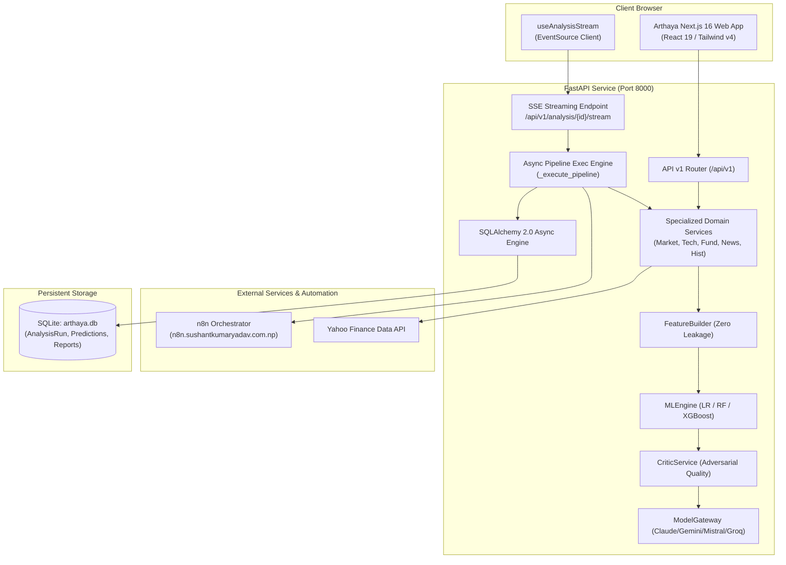

# Arthaya (FinanceAgent) — Technical Documentation Master Hub

Welcome to the comprehensive technical documentation for **Arthaya** (formerly conceptualized as NEXUS in initial specifications), an advanced multi-agent, multi-model equity research and quantitative prediction intelligence platform.

> [!NOTE]
> This documentation suite reflects the **actual repository implementation** as verified across the backend engine, Next.js frontend, and n8n orchestration pipelines. It distinguishes verified functional systems from partial implementations, mocks, and planned infrastructure.

---

## 🧭 Documentation Navigator

### 1. Overview & Strategy
- [Project Overview & Feature Inventory](file:///home/sushant/Projects/Agentic/FinanceAgent/docs/project-overview.md): Product identity, objectives, design philosophy, implementation maturity audit, and feature matrix.

### 2. Architecture & Design
- [System Architecture](file:///home/sushant/Projects/Agentic/FinanceAgent/docs/architecture/system-architecture.md): Monorepo topology, C4 model, layer boundaries, and execution models.
- [Multi-Agent Pipeline](file:///home/sushant/Projects/Agentic/FinanceAgent/docs/architecture/multi-agent-pipeline.md): The 9-agent pipeline specification, dependency graph, and agent roles.
- [Sequence Diagrams](file:///home/sushant/Projects/Agentic/FinanceAgent/docs/architecture/sequence-diagrams.md): Interactive choreography for SSE streaming, n8n webhook triggering, and local fallback paths.
- [Data Flow Diagrams](file:///home/sushant/Projects/Agentic/FinanceAgent/docs/architecture/data-flow-diagrams.md): Data ingestion, feature engineering, zero-leakage enforcement, and model inference flows.

### 3. Backend Subsystem (`backend/`)
- [Backend Architecture](file:///home/sushant/Projects/Agentic/FinanceAgent/docs/backend/architecture.md): FastAPI application design, lifespan management, CORS configuration, and modular routers.
- [API Reference](file:///home/sushant/Projects/Agentic/FinanceAgent/docs/backend/api-reference.md): Complete REST & Server-Sent Events endpoint specifications with request/response schemas.
- [Services & Agent Implementations](file:///home/sushant/Projects/Agentic/FinanceAgent/docs/backend/services-and-agents.md): Deep-dive into Market, Technical, Fundamental, News, Historical, ML Engine, and Critic services.
- [Model Gateway Integration](file:///home/sushant/Projects/Agentic/FinanceAgent/docs/backend/model-gateway.md): Multi-model LLM routing (Claude, Gemini, Mistral, Groq, OpenRouter) and structured prompt synthesis.
- [Database Schema & ER Reference](file:///home/sushant/Projects/Agentic/FinanceAgent/docs/backend/database-and-models.md): SQLAlchemy 2.0 models, SQLite runtime state, PostgreSQL target configuration, and ER diagrams.

### 4. Frontend Subsystem (`arthaya/`)
- [Frontend Architecture](file:///home/sushant/Projects/Agentic/FinanceAgent/docs/frontend/architecture.md): Next.js 16 App Router, React 19 architecture, Server vs. Client component topology.
- [Design System & UI Tokens](file:///home/sushant/Projects/Agentic/FinanceAgent/docs/frontend/design-system.md): Tailwind CSS v4 design tokens, Arthaya Emerald palette, monospace typography, and chart theming.
- [Routes & Views Reference](file:///home/sushant/Projects/Agentic/FinanceAgent/docs/frontend/routes-and-views.md): Guide to all 12 dashboard views, workspace layouts, and stock detail sub-routes.
- [State Management & Data Fetching](file:///home/sushant/Projects/Agentic/FinanceAgent/docs/frontend/state-and-data-fetching.md): Dual-mode execution (demo mock repository vs. live API backend), SSE event consumption, and localStorage.

### 5. Orchestration Subsystem (`n8n/`)
- [n8n Workflows Specification](file:///home/sushant/Projects/Agentic/FinanceAgent/docs/orchestration/n8n-workflows.md): Node-by-node inspection of the remote orchestrator workflow, parallel fan-out, and SSRF security hardening.
- [Deployment & Synchronization](file:///home/sushant/Projects/Agentic/FinanceAgent/docs/orchestration/deployment-and-sync.md): Workflow deployment scripts, webhook triggers, callback contracts, and local fallback mechanics.

### 6. Operations & Deployment
- [Local Setup & Development](file:///home/sushant/Projects/Agentic/FinanceAgent/docs/deployment-and-operations/local-setup.md): Step-by-step setup guide for Python virtual environment, Next.js Node runtime, and dependencies.
- [Configuration Guide](file:///home/sushant/Projects/Agentic/FinanceAgent/docs/deployment-and-operations/configuration-guide.md): Complete catalog of environment variables for backend and frontend.
- [Docker & Containerization](file:///home/sushant/Projects/Agentic/FinanceAgent/docs/deployment-and-operations/docker-and-containers.md): Dockerfile inspection, container execution, and deployment recommendations.
- [Troubleshooting & Diagnostics](file:///home/sushant/Projects/Agentic/FinanceAgent/docs/deployment-and-operations/troubleshooting.md): Diagnosis playbook for yfinance rate limiting, n8n connectivity, database locks, and SSE drops.

### 7. Architecture Decision Records (ADRs)
- [ADR-001: n8n Workflow Hub vs. LangGraph](file:///home/sushant/Projects/Agentic/FinanceAgent/docs/architecture-decisions/ADR-001-n8n-vs-langgraph.md)
- [ADR-002: Dual-Mode Execution Architecture (Mock vs. Live)](file:///home/sushant/Projects/Agentic/FinanceAgent/docs/architecture-decisions/ADR-002-dual-mode-architecture.md)
- [ADR-003: Zero-Leakage Timestamp Cutoff Strategy](file:///home/sushant/Projects/Agentic/FinanceAgent/docs/architecture-decisions/ADR-003-zero-leakage-features.md)
- [ADR-004: Quant ML Model Ensemble & Probability Calibration](file:///home/sushant/Projects/Agentic/FinanceAgent/docs/architecture-decisions/ADR-004-quant-ensemble-method.md)

---

## 🏛️ High-Level System Architecture

---

## 🔍 Implementation Verification Summary

| Component | Implemented | Source Evidence |
| :--- | :--- | :--- |
| **FastAPI REST API** | Yes | [main.py](file:///home/sushant/Projects/Agentic/FinanceAgent/backend/app/main.py), [router.py](file:///home/sushant/Projects/Agentic/FinanceAgent/backend/app/api/v1/router.py) |
| **Real Technical Indicators** | Yes | [technical_service.py](file:///home/sushant/Projects/Agentic/FinanceAgent/backend/app/services/technical_service.py) |
| **Fundamental Metrics** | Yes | [fundamental_service.py](file:///home/sushant/Projects/Agentic/FinanceAgent/backend/app/services/fundamental_service.py) |
| **News Sentiment & Events** | Yes | [news_service.py](file:///home/sushant/Projects/Agentic/FinanceAgent/backend/app/services/news_service.py) |
| **Ensemble ML Predictions** | Yes | [ml_engine.py](file:///home/sushant/Projects/Agentic/FinanceAgent/backend/app/services/ml_engine.py) |
| **Server-Sent Events** | Yes | [analysis.py](file:///home/sushant/Projects/Agentic/FinanceAgent/backend/app/api/v1/analysis.py), [useAnalysisStream.ts](file:///home/sushant/Projects/Agentic/FinanceAgent/arthaya/src/hooks/useAnalysisStream.ts) |
| **n8n Orchestration Workflows** | Yes | [arthaya_analysis_orchestrator_fixed.json](file:///home/sushant/Projects/Agentic/FinanceAgent/n8n/workflows/arthaya_analysis_orchestrator_fixed.json) |
| **Next.js 16 Dashboard UI** | Yes | [arthaya/src/app/](file:///home/sushant/Projects/Agentic/FinanceAgent/arthaya/src/app/) |
| **Database Persistence** | Partial | Persists analysis runs & predictions; other endpoints return demo JSON ([database-and-models.md](file:///home/sushant/Projects/Agentic/FinanceAgent/docs/backend/database-and-models.md)) |
| **Authentication Flow** | Stubbed | Visual pages only; service throws "not configured" ([authService.ts](file:///home/sushant/Projects/Agentic/FinanceAgent/arthaya/src/services/authService.ts)) |
