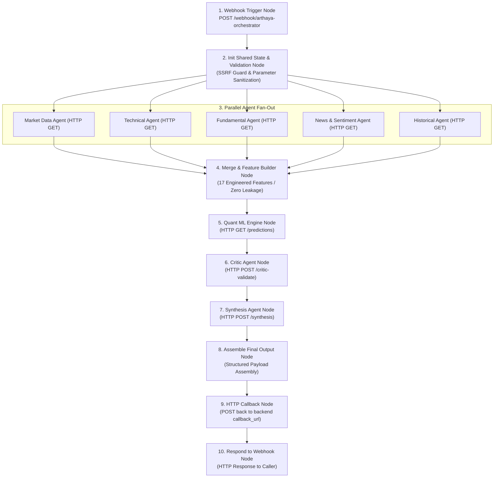

# n8n Orchestrator Workflows Specification

## 1. Orchestration Architecture

The asynchronous execution of the 9-agent analysis pipeline is automated using an external **n8n** workflow orchestrator instance hosted at `https://n8n.sushantkumaryadav.com.np`.

Two workflow configurations exist in the repository:
1. `n8n/workflows/arthaya_analysis_orchestrator.json`: The standard baseline workflow.
2. `n8n/workflows/arthaya_analysis_orchestrator_fixed.json`: The hardened production workflow featuring input validation, SSRF defense, parallel data fan-out, and graceful degradation.



---

## 2. Node-by-Node Specification (`arthaya_analysis_orchestrator_fixed.json`)

### Node 1: Webhook Trigger (`node-webhook-trigger`)
- **Type**: `n8n-nodes-base.webhook` (TypeVersion 2)
- **Path**: `arthaya-orchestrator`
- **Method**: `POST`
- **Response Mode**: `responseNode` (defers HTTP response until workflow completion)

---

### Node 2: Init Shared State & Input Guard (`node-init-state`)
- **Type**: `n8n-nodes-base.code` (JavaScript)
- **Security & SSRF Guard**:
  - Restricts caller-supplied `backend_url` and `callback_url` parameters against `ALLOWED_HOST_SUFFIXES = ['trycloudflare.com']`. Rejects unauthorized hosts to prevent Server-Side Request Forgery (SSRF).
  - Validates `ticker` against regex `^[A-Z0-9.\-^=]{1,15}$`.
  - Validates `horizon` against regex `^\d{1,3}[DWMY]$`.
  - Enforces `depth` membership in `["quick", "standard", "deep", "full"]`.
  - Normalizes `gateway_provider` (default: `"claude"`).

---

### Nodes 3–7: Parallel Data Extraction Workers
- **Type**: `n8n-nodes-base.httpRequest` (TypeVersion 3)
- Dispatched concurrently:
  1. `Market Data Agent`: `GET {{backend_url}}/api/v1/stocks/{{ticker}}`
  2. `Technical Agent`: `GET {{backend_url}}/api/v1/stocks/{{ticker}}/technical`
  3. `Fundamental Agent`: `GET {{backend_url}}/api/v1/stocks/{{ticker}}/fundamentals`
  4. `News & Sentiment Agent`: `GET {{backend_url}}/api/v1/stocks/{{ticker}}/news`
  5. `Historical Agent`: `GET {{backend_url}}/api/v1/stocks/{{ticker}}/historical`
- **Error Handling**: Configured with `continueOnFail: true` so transient failure of non-critical data feeds does not abort the entire pipeline.

---

### Node 8: Feature Builder Node (`node-feature-builder`)
- **Type**: `n8n-nodes-base.code`
- Merges the responses from all 5 data agents into a structured state object. Attaches metadata:
  ```json
  {
    "features_engineered": 17,
    "cutoff_enforced": true
  }
  ```

---

### Node 9: Quant ML Engine (`node-ml-engine`)
- **Type**: `n8n-nodes-base.httpRequest`
- **Target**: `GET {{backend_url}}/api/v1/predictions/{{ticker}}?horizon={{horizon}}`
- **Role**: Mandatory stage. Ingests engineered features and evaluates the ML model ensemble.

---

### Node 10: Adversarial Critic Agent (`node-critic-agent`)
- **Type**: `n8n-nodes-base.httpRequest`
- **Target**: `POST {{backend_url}}/api/v1/analysis/critic-validate`
- **Payload**:
  ```json
  {
    "analysis_id": "={{ $json.analysis_id }}",
    "ticker": "={{ $json.ticker }}"
  }
  ```

---

### Node 11: Synthesis Agent (Model Gateway) (`node-synthesis-agent`)
- **Type**: `n8n-nodes-base.httpRequest`
- **Target**: `POST {{backend_url}}/api/v1/analysis/synthesis`
- **Payload**:
  ```json
  {
    "analysis_id": "={{ $json.analysis_id }}",
    "ticker": "={{ $json.ticker }}",
    "gateway_provider": "={{ $json.gateway_provider }}"
  }
  ```

---

### Node 12 & 13: Final Assembly & Response
- **Assemble Final Output**: Packages `analysis_id`, `ticker`, `horizon`, `prediction`, `critic`, and `summary` into the canonical research format.
- **Respond to Webhook**: Flushes the complete JSON response back to the initial HTTP caller.
