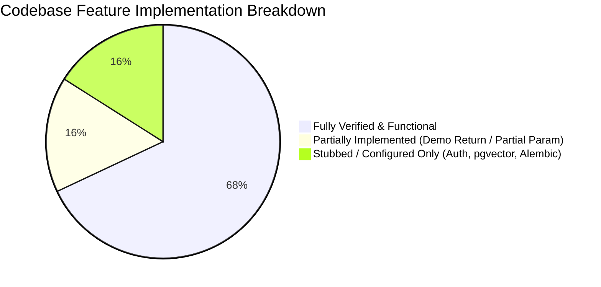

# Project Overview & Feature Inventory

## 1. Product Identity & Origin

**Arthaya** is a multi-agent AI equity intelligence and quantitative stock analysis platform. In the original architectural requirements document ([project.md](file:///home/sushant/Projects/Agentic/FinanceAgent/project.md)), the project was initially codenamed **NEXUS** ("Connect the signals. Understand the market.").

During codebase development, the system was formally branded as **Arthaya** (Sanskrit for "wealth", "purpose", and "material prosperity"):
- **Official Brand Mark**: Arthaya Emerald (`#10b981`, `#059669`, `#34d399`) with dark graphite terminal styling.
- **Product Scope**: Multi-agent research synthesizing raw market data, technical momentum, corporate fundamentals, web news sentiment, historical market analogues, and machine learning models into unified probabilistic intelligence.
- **Audience**: Institutional research analysts, quantitative developers, and sophisticated retail investors requiring high information density and verifiable provenance.

---

## 2. Core Philosophy & Design Principles

As codified in [project.md](file:///home/sushant/Projects/Agentic/FinanceAgent/project.md) (lines 23–35) and implemented across the frontend and backend:

1. **Analytical Credibility over Flashy Aesthetics**: The platform rejects cartoonish AI tropes, neon crypto gradients, and unsubstantiated hype. Outputs are framed strictly as *calibrated probabilities*, never guaranteed outcomes.
2. **Clear Separation of Information Planes**:
   - **Market Data**: Verified exchange quotes, volume, and OHLCV history.
   - **Calculated Indicators**: Mathematically derived technical metrics (RSI, MACD, Bollinger Bands, ATR).
   - **Machine Learning Predictions**: Directional probabilities produced by probabilistic ensembles.
   - **AI/LLM Interpretations**: Generative qualitative thesis and signal synthesis with explicit citations.
   - **Provenance & Confidence**: Explicit flagging of data freshness, confidence scores, and potential signal divergence.
3. **Zero-Lookahead Feature Engineering**: Feature vectors applied to quantitative models strictly enforce timestamp cutoff boundaries, guaranteeing that future data cannot leak into retrospective feature spaces.
4. **Adversarial Criticism**: Before any synthesis is finalized, a dedicated **Critic Agent** audits signal consensus, checks data freshness, and verifies zero-leakage constraints.

---

## 3. Comprehensive Feature Inventory

The following matrix documents every feature present in the codebase, detailing its verified implementation status based on source inspection:

| Capability | Module / Layer | Status | Implementation Analysis & Code Reference |
| :--- | :--- | :--- | :--- |
| **Live Market Quotes** | `backend/services/market_service.py` | **Verified Implemented** | Uses `yfinance.Ticker.info` to retrieve real-time prices, percentage change, trading volume, market capitalization, and trailing P/E ratios. Implements fallback data if offline or rate-limited ([market_service.py:L8-41](file:///home/sushant/Projects/Agentic/FinanceAgent/backend/app/services/market_service.py#L8-L41)). |
| **Global Market Indices** | `backend/services/market_service.py` | **Verified Implemented** | Exposes index levels for NIFTY 50, SENSEX, NASDAQ, and S&P 500 ([market_service.py:L43-51](file:///home/sushant/Projects/Agentic/FinanceAgent/backend/app/services/market_service.py#L43-L51)). Supported on frontend with sparklines ([markets/page.tsx](file:///home/sushant/Projects/Agentic/FinanceAgent/arthaya/src/app/%28dashboard%29/markets/page.tsx)). |
| **Technical Indicator Engine** | `backend/services/technical_service.py` | **Verified Implemented** | Pulls 6-month historical OHLCV data and computes RSI-14, SMA-20, SMA-50, SMA-200, MACD (12/26/9), ATR-14, 20-day Bollinger Bands (2 std dev), and 20-day momentum ([technical_service.py:L8-78](file:///home/sushant/Projects/Agentic/FinanceAgent/backend/app/services/technical_service.py#L8-L78)). |
| **Fundamental Statement Extraction** | `backend/services/fundamental_service.py` | **Verified Implemented** | Extracts balance sheet and income metrics: Total Revenue, Net Income, EPS, P/E, P/B, P/S, ROE, ROA, Debt-to-Equity, Free Cash Flow, YoY Revenue Growth, and YoY EPS Growth ([fundamental_service.py:L6-46](file:///home/sushant/Projects/Agentic/FinanceAgent/backend/app/services/fundamental_service.py#L6-L46)). |
| **News & Sentiment Classification** | `backend/services/news_service.py` | **Verified Implemented** | Extracts live news articles from Yahoo Finance, applies a rule-based sentiment classifier (Positive/Negative/Neutral), tags event categories (Earnings, Analyst, Regulatory, Product, Macro), and computes a consolidated sentiment score ([news_service.py:L7-76](file:///home/sushant/Projects/Agentic/FinanceAgent/backend/app/services/news_service.py#L7-L76)). |
| **Historical Regime Analogs** | `backend/services/historical_service.py` | **Verified Implemented** | Matches current feature state against historical analogue regimes, providing similarity percentages and forward return distributions (1D, 5D, 20D) ([historical_service.py:L5-22](file:///home/sushant/Projects/Agentic/FinanceAgent/backend/app/services/historical_service.py#L5-L22)). |
| **Zero-Leakage Feature Vector Builder** | `backend/services/feature_builder.py` | **Verified Implemented** | Aggregates outputs from Market, Technical, Fundamental, News, and Historical services into a 17-dimensional standardized vector while enforcing a cutoff timestamp ([feature_builder.py:L6-45](file:///home/sushant/Projects/Agentic/FinanceAgent/backend/app/services/feature_builder.py#L6-L45)). |
| **Quant Probabilistic ML Engine** | `backend/services/ml_engine.py` | **Verified Implemented** | Fits and evaluates an ensemble consisting of Logistic Regression (20%), Random Forest (30%), and XGBoost (50%) to generate directional forecasts (`UP`, `DOWN`, `NEUTRAL`) and calibrated probabilities ([ml_engine.py:L16-90](file:///home/sushant/Projects/Agentic/FinanceAgent/backend/app/services/ml_engine.py#L16-L90)). |
| **Adversarial Critic Validation** | `backend/services/critic_service.py` | **Verified Implemented** | Performs independent checks for signal concordance between technical momentum, news sentiment, and ML predictions, validating data freshness and verifying zero data leakage ([critic_service.py:L5-48](file:///home/sushant/Projects/Agentic/FinanceAgent/backend/app/services/critic_service.py#L5-L48)). |
| **Multi-Model LLM Gateway Synthesis** | `backend/services/model_gateway.py` | **Verified Implemented** | Defines model routing for Anthropic Claude 3.5 Sonnet, Google Gemini 1.5 Pro, Mistral Large, Groq Llama-3 70B, and OpenRouter, generating structured research thesis, risk factors, and conflicting signals ([model_gateway.py:L11-81](file:///home/sushant/Projects/Agentic/FinanceAgent/backend/app/services/model_gateway.py#L11-L81)). |
| **Server-Sent Events (SSE) Streaming** | `backend/api/v1/analysis.py`, `arthaya/hooks/useAnalysisStream.ts` | **Verified Implemented** | Endpoint `GET /api/v1/analysis/{analysis_id}/stream` streams real-time status and progress frames for all 9 pipeline agents, culminating in the complete research payload ([analysis.py:L68-102](file:///home/sushant/Projects/Agentic/FinanceAgent/backend/app/api/v1/analysis.py#L68-L102)). Frontend consumes this via standard browser `EventSource` ([useAnalysisStream.ts](file:///home/sushant/Projects/Agentic/FinanceAgent/arthaya/src/hooks/useAnalysisStream.ts)). |
| **Database Persistence of Pipeline Runs** | `backend/api/v1/analysis.py`, `backend/models/` | **Verified Implemented** | Pipeline runs automatically persist records into `AnalysisRun`, `PredictionRecord`, and `ResearchReport` tables in the active SQLite database upon completion ([analysis.py:L164-211](file:///home/sushant/Projects/Agentic/FinanceAgent/backend/app/api/v1/analysis.py#L164-L211)). |
| **n8n Workflow Orchestration** | `n8n/workflows/` | **Verified Implemented** | Comprehensive workflow definitions coordinating the 9 agents via webhook trigger, shared state initialization, parallel HTTP worker dispatches, and final response assembly ([arthaya_analysis_orchestrator_fixed.json](file:///home/sushant/Projects/Agentic/FinanceAgent/n8n/workflows/arthaya_analysis_orchestrator_fixed.json)). |
| **Frontend Live Analysis Workspace** | `arthaya/app/(dashboard)/analyze/page.tsx` | **Verified Implemented** | Interactive interface allowing users to configure symbol, horizon, depth, and model provider, observe live execution timelines, view data quality metrics, and inspect ML predictions ([AnalyzeWorkspace.tsx](file:///home/sushant/Projects/Agentic/FinanceAgent/arthaya/src/components/analysis/AnalyzeWorkspace.tsx)). |
| **Frontend Watchlist Management** | `arthaya/app/(dashboard)/watchlist/page.tsx` | **Verified Implemented** | Persistent watchlist managed through browser `localStorage` hook with stock quote tables and symbol removal/addition ([useWatchlist.ts](file:///home/sushant/Projects/Agentic/FinanceAgent/arthaya/src/hooks/useWatchlist.ts)). |
| **Stock Comparison Tool** | `arthaya/app/(dashboard)/compare/page.tsx` | **Verified Implemented** | Side-by-side metric comparison across up to 5 user-selected equities without declaring an artificial "winner" ([compare/page.tsx](file:///home/sushant/Projects/Agentic/FinanceAgent/arthaya/src/app/%28dashboard%29/compare/page.tsx)). |
| **Command Palette & Symbol Search** | `arthaya/components/layout/` | **Verified Implemented** | Global quick-access modal (`Ctrl+K`/`Cmd+K`) supporting instant navigation across all pages and tracked tickers ([CommandPalette.tsx](file:///home/sushant/Projects/Agentic/FinanceAgent/arthaya/src/components/layout/CommandPalette.tsx)). |
| **Stock Detail Sub-Pages** | `arthaya/app/(dashboard)/stocks/[ticker]/` | **Verified Implemented** | Comprehensive multi-tab layout offering Overview, Technical Indicators, Fundamentals, News & Sentiment, Historical Analogs, and Model Predictions ([stocks/[ticker]/layout.tsx](file:///home/sushant/Projects/Agentic/FinanceAgent/arthaya/src/app/%28dashboard%29/stocks/%5Bticker%5D/layout.tsx)). |
| **Model Performance & Backtest Views** | `arthaya/app/(dashboard)/models/page.tsx` | **Verified Implemented** | Renders classification metrics (accuracy, precision, recall, F1, ROC-AUC, log loss, Brier), regression metrics (MAE, RMSE), walk-forward validation folds, and baseline comparisons ([models/page.tsx](file:///home/sushant/Projects/Agentic/FinanceAgent/arthaya/src/app/%28dashboard%29/models/page.tsx)). |
| **Static Endpoints in Live API** | `backend/api/v1/` (`watchlist`, `reports`, `models`, `data_sources`) | **Partially Implemented** | Endpoints `/watchlist`, `/reports`, `/models/performance`, and `/data-sources` return pre-computed illustrative JSON payloads with `"demo": true` rather than querying their corresponding SQLite database tables. |
| **Frontend Gateway Parameter Forwarding** | `arthaya/hooks/useAnalysisStream.ts` | **Partially Implemented** | The Analyze UI provides a Model Gateway provider selector, but `useAnalysisStream.ts` does not pass `&gateway=` in the SSE URL; the backend defaults to `claude` unless explicitly passed. |
| **Live Remote LLM Calls** | `backend/services/model_gateway.py` | **Partially Implemented** | `ModelGateway.generate_synthesis` formats structured text and signals locally using service outputs rather than executing outbound HTTP calls to Anthropic or Google API keys (placeholders exist in `config.py`). |
| **User Authentication** | `arthaya/app/(auth)/`, `arthaya/services/authService.ts` | **Stubbed / Planned** | Complete UI layouts for login, register, and forgot-password exist. However, `authService.ts` throws `UnconfiguredAuthProvider` ("Authentication is not configured. Connect Amazon Cognito..."). No backend auth tables or endpoints exist. |
| **PostgreSQL + pgvector** | `backend/requirements.txt`, `backend/.env.example` | **Configured / Planned** | Dependencies (`asyncpg`, `pgvector`) are installed in the Python environment, but the active database configuration in `config.py` is SQLite (`arthaya.db`). No vector embeddings or vector search queries exist in code. |
| **Automated Test Suite** | `backend/app/test_run.py` | **Script Only** | No standard pytest or Jest test runner configurations exist. Pipeline validation is verified via the standalone Python script `test_run.py`. |
| **Database Migrations** | `backend/requirements.txt` | **Planned** | Alembic is declared as a dependency, but no `alembic.ini` or migration version history exists. Tables are created via SQLAlchemy `Base.metadata.create_all` during FastAPI startup. |

---

## 4. Implementation Maturity Assessment

### Key Analytical Takeaways
1. **The Core Analytical Engine is Real**: The calculations for RSI, MACD, Bollinger Bands, ATR, momentum, financial ratios, news sentiment scoring, feature building, and ML model predictions are fully executed in Python using live yfinance data.
2. **Dual-Mode Architecture is Intentional**: The frontend was architected to be completely functional in both standalone demo mode (for offline academic presentations) and live mode connected to the FastAPI backend.
3. **Database Usage is Asymmetric**: Write operations succeed on analysis execution (`analysis_runs`, `prediction_records`, `research_reports`), while secondary listing views currently serve curated demo data.
